# Settings Hub для ComfyUI

[](#как-это-работает)
[](#разработка-и-тесты)
[](#как-это-работает)
[](#установка)

**Settings Hub** — нода-«пульт» для ComfyUI: забирает виджеты любых нод на одну
панель с **двусторонней синхронизацией в реальном времени** — без проводов,
вспомогательных нод и опроса сервера. Плюс вкладки, пресеты, батч-очередь,
живые встраивания панелей сторонних нод, галерея-вьювер, точки навигации по
воркфлоу с горячими клавишами, **Paste Stack** (история буфера обмена с
серверным хранением), **LLM Chat** (чат с локальными/облачными моделями
в плавающем окне) и **Image Compare** (A/B-сравнение картинок).

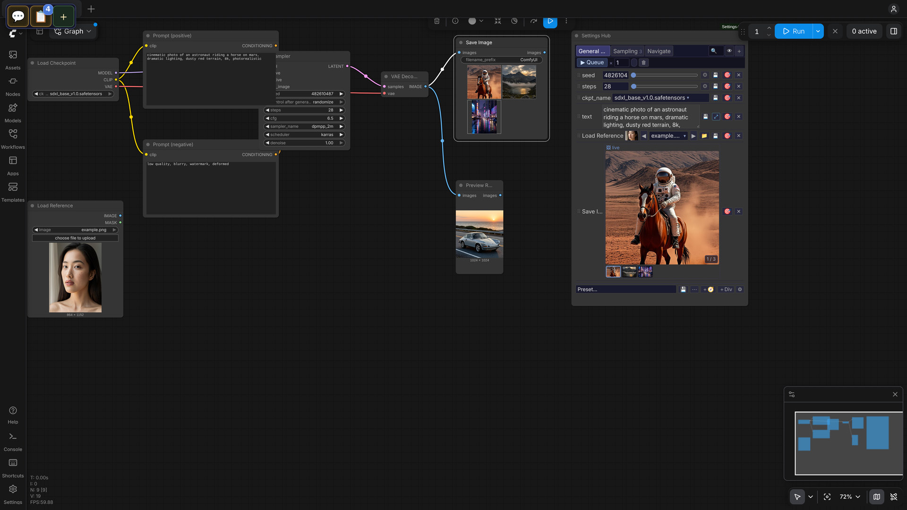

Вся логика живёт на фронте (`web/`, ES-модули) — Python-часть это заглушка,
которая не исполняется при постановке в очередь и не влияет на граф.

---

## Содержание

1. [Установка](#установка)
2. [Быстрый старт](#быстрый-старт)
3. [Возможности](#возможности)
   - [Панель-хаб и зеркала виджетов](#панель-хаб-и-зеркала-виджетов)
   - [Пиннинг: 4 пути + batch-пикер](#пиннинг-4-пути--batch-пикер)
   - [Умные зеркала: combo с поиском, слайдеры с override, кнопки](#умные-зеркала)
   - [Queue ×N и живой статус очереди](#queue-n-и-живой-статус-очереди)
   - [Пресеты 2.0](#пресеты-20)
   - [Медиа-строки и пикер файлов](#медиа-строки-и-пикер-файлов)
   - [Галерея-вьювер и фуллскрин](#галерея-вьювер-и-фуллскрин)
   - [Живые порталы: встраивание панелей нод](#живые-порталы)
   - [Плавающее окно (пин на экран)](#плавающее-окно)
   - [Виртуальные хабы (v90)](#виртуальные-хабы-v90)
   - [Размер шрифта интерфейса (v90)](#размер-шрифта-интерфейса-v90)
   - [Минипанель (v91)](#минипанель-v91)
   - [Точки навигации 🧭](#точки-навигации)
   - [Горячие клавиши точек](#горячие-клавиши-точек)
   - [Paste Stack 📋 (история буфера обмена)](#paste-stack)
   - [Image Compare ⇆ (A/B-сравнение)](#image-compare)
   - [LLM Chat (чат с моделями)](#llm-chat)
   - [Workflows Manager 🗂 (v101-v108)](#workflows-manager)
   - [Глобальные настройки ⚙](#глобальные-настройки)
4. [Как это работает](#как-это-работает)
5. [Разработка и тесты](#разработка-и-тесты)
6. [Устранение неполадок](#устранение-неполадок)

---

## Установка

**ComfyUI Manager:** Custom Nodes Manager → `Settings Hub` → Install.

**Вручную:**

```bash
cd ComfyUI/custom_nodes
git clone <url-этого-репозитория> ComfyUI-Settings-Hub
```

Перезапустите ComfyUI (после обновления — **Ctrl+F5**, см.
[устранение неполадок](#устранение-неполадок)). Нода появится в меню как
**Settings Hub**.

## Быстрый старт

1. Добавьте на граф ноду **Settings Hub**.
2. Кликните **ПКМ по любой ноде** → «📦 Add widgets to hub (batch)…» или
   «📌 Pin to Settings Hub» — виджет появится в хабе и будет зеркалить
   значение в обе стороны.
3. По желанию: разложите виджеты по вкладкам, сохраните пресет, превратите
   хаб в плавающее окно (ПКМ по ноде → 🪄 **Dematerialize**) или добавьте
   точки навигации 🧭.

## Возможности

### Панель-хаб и зеркала виджетов

Одна нода — один пульт. Каждая строка хаба — живое зеркало виджета ноды-источника:
значение меняется с **обеих сторон мгновенно** (реактивная шина событий, без
опроса). Строки можно перетаскивать (DnD), переименовывать, искать, удалять;
виджеты раскладываются по вкладкам (переименование — двойной клик), есть
разделители и режим скрытия служебного «хрома» (👁).

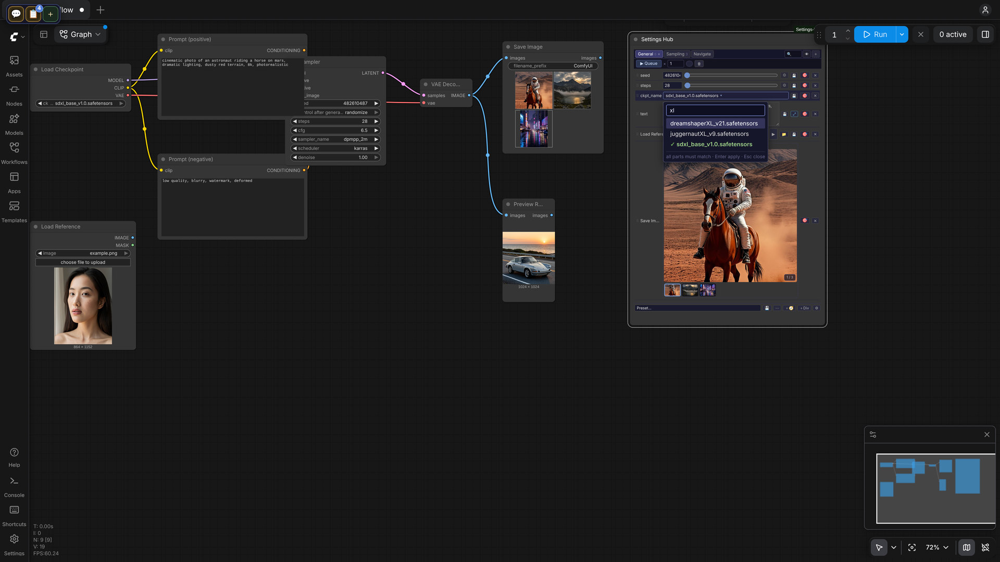

### Пиннинг: 4 пути + batch-пикер

- **ПКМ по виджету** — точечный пин конкретного контрола;
- **ПКМ по ноде** → «📌 Pin to Settings Hub ▸» (выбор хаба/вкладки/новой
  вкладки);
- **Ctrl/Cmd+ПКМ** — перехват поверх родных меню панелей;
- **Shift+ПКМ** — эскейп-хатч к нативному браузерному меню.

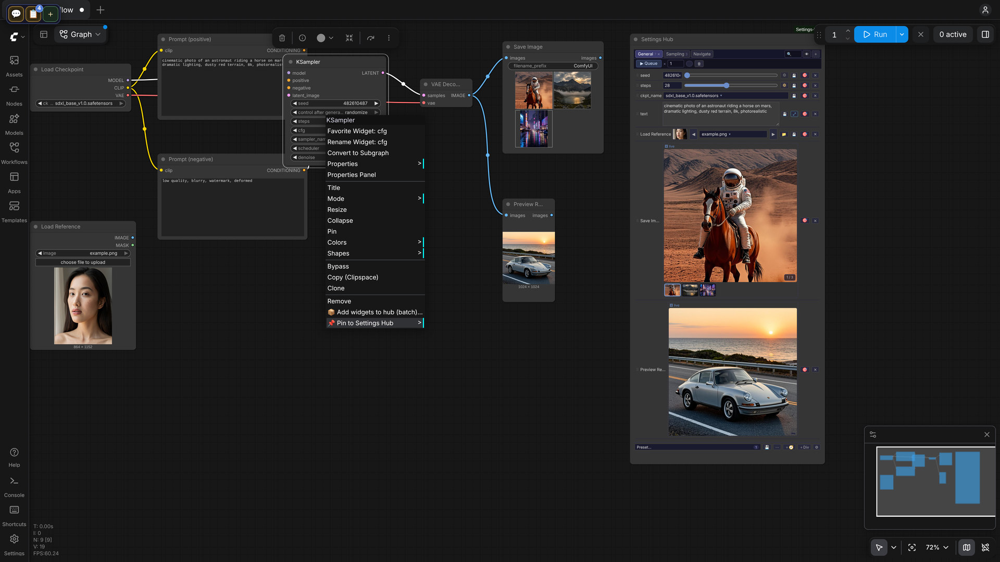

«📦 Add widgets to hub (batch)…» открывает пикер: чекбоксы по всем виджетам
ноды с типами (combo/slider/int/toggle/button/panel), выбор целевого хаба и
вкладки, «Add N» одним кликом.

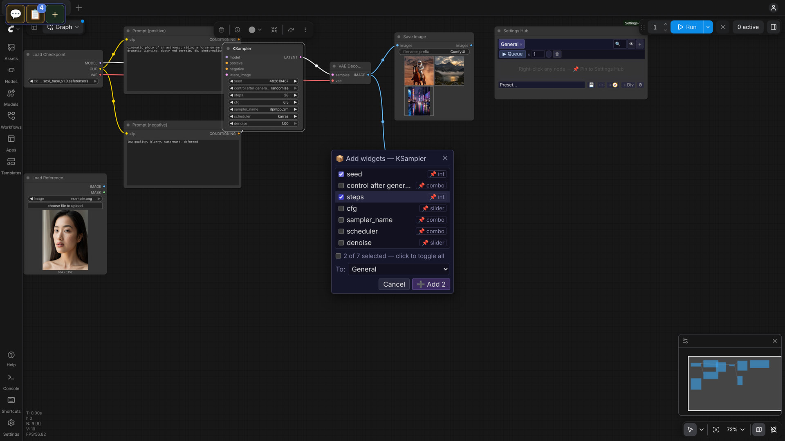

### Умные зеркала

- **Combo с живым поиском** — фильтр по подстроке (все части должны
  совпадать), длинные пути моделей показываются в две строки
  (basename жирным + каталог приглушённо), закрытый триггер остаётся
  компактным;
- **Слайдеры** — колесо мыши меняет значение; через ⚙ на строке задаются
  кастомные min/max/step с применением к реальной ноде («Push») и возвратом
  («Clear»), есть режим авто-применения; синтетические слайдеры строятся для
  «голых» чисел (seed, steps);
- **Кнопки** — зеркала кнопок нод (rgthree «🎲 Randomize Each Time» и т.п.)
  запускаются прямо из хаба, не трогая значение;
- **Текст** — однострочные и многострочные поля с ресайзом по высоте.


### Queue ×N и живой статус очереди

Панель ▶ **Queue** под вкладками: постановка промпта в очередь N раз
(до 1000), живой бейдж оставшихся задач из событий сервера, кнопка ⏹ отмены
выполнения. Источник истины — события `app.api` (status / executing /
execution_success), поллинг не используется. Виден на общем плане хаба
(см. [герой](#панель-хаб-и-зеркала-виджетов)).

### Пресеты 2.0

Снапшоты **активной вкладки**: быстрое сохранение, применение с инспекцией
(валидация combo, клэмп значений, частичное применение), undo, избранное,
объединение пресетов, экспорт/импорт текстом, массовое включение/исключение
строк. Точки навигации и кнопки в пресеты не попадают — только значения.

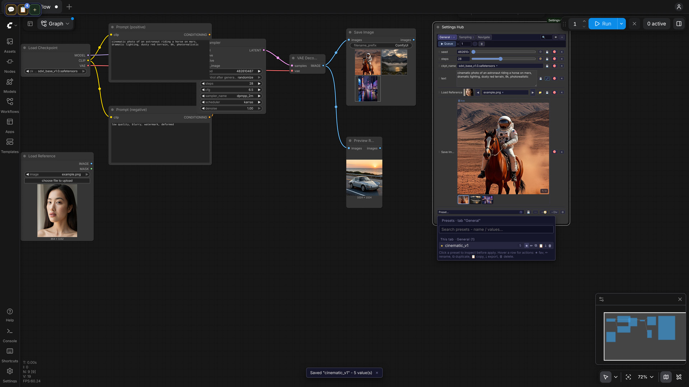

### Медиа-строки и пикер файлов

Загрузчики изображений/видео/аудио (включая «Load Image AIO») пиннятся одной
строкой: миниатюра, searchable combo файлов, кнопка upload, drag&drop и
**вставка из буфера (Ctrl+V)** прямо в строку хаба. Наведение показывает
увеличенное превью (задержка и размер настраиваются).

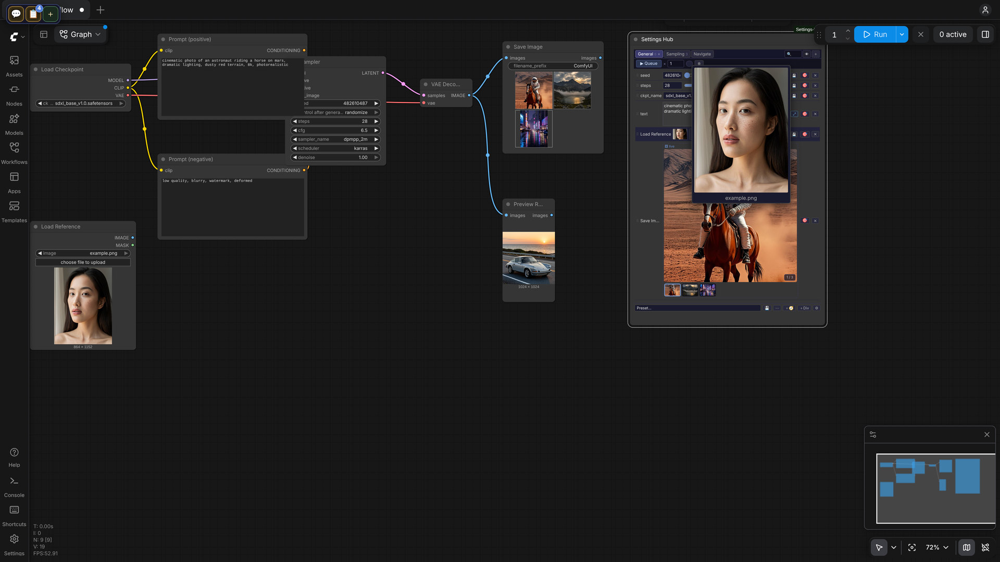

Клик по превью открывает **пикер файлов** — рекурсивный обход папок ComfyUI
(`input`/`output` и др., эндпоинт `/settings_hub/list_media` из этого репо),
фильтры по типу (All/Images/Videos/Audio/Recent), размер миниатюр, выбор
кликом.

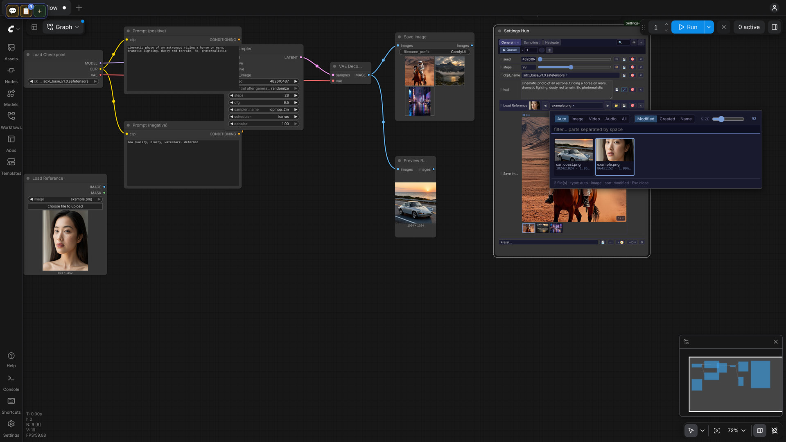

### Галерея-вьювер и фуллскрин

Строка «Pin viewer (live embed)» превращает выходную ноду (SaveImage,
PreviewImage, видео-комбайнеры…) в **батч-галерею** прямо в хабе: счётчик
кадров, миниатюры, кнопки скачивания ⬇, полноэкранный режим с навигацией
(←/→/Esc/колесо).

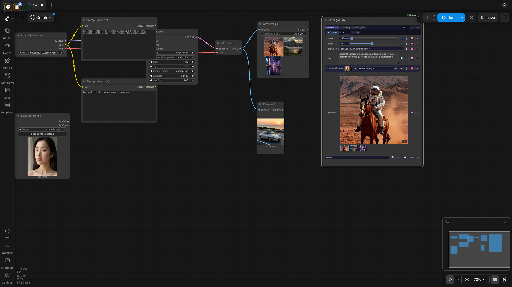

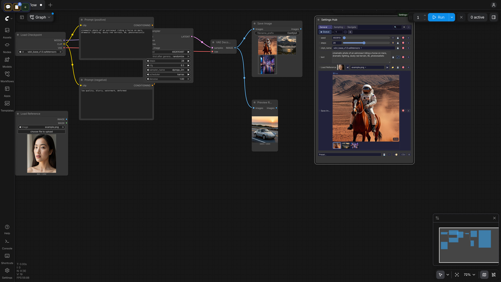

### Живые порталы

Пункты «🪟 Pin custom panel (live embed)», «🖼 Pin viewer (live embed)» и
«🎛 Pin node UI (live embed)» встраивают в хаб **живые панели** сторонних нод:
DOM-панели клонируются «призраком» (оригинал никогда не покидает ноду, клики
перенаправляются в оригинал, мутации источника перестраивают зеркало),
канвас-панели рендерятся 1:1 с форвардингом кликов. Нода остаётся полностью
рабочей на графе.

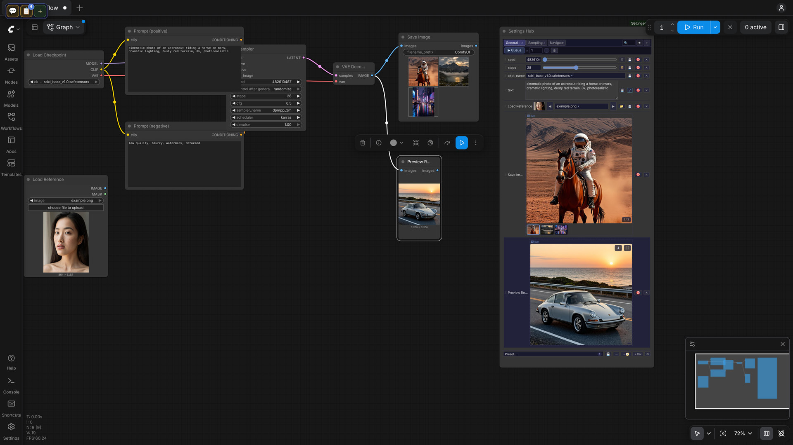

### Плавающее окно

С v92 хаб — **либо нода на канве, либо плавающее окно**. ПКМ по ноде хаба →
«🪄 Dematerialize - turn into a floating window» — нода прячется с канвы, а та
же панель (все пины, вкладки и пресеты на месте) начинает жить в плавающем
окне поверх графа: драг за заголовок, ресайз за грип (размер запоминается),
кнопка «–» (свёртывание), режим **авто-сворачивания** (окно складывается,
когда курсор уходит, и раскрывается по наведению на заголовок — тайминги
в ⚙). Обратный путь — 📌 в шапке окна («материализовать» обратно в ноду).
ПКМ по окну даёт «✏ Rename hub» (v93). Окно переживает смену воркфлоу и
зумы; файл-drag на свёрнутом окне раскрывает его для вставки.

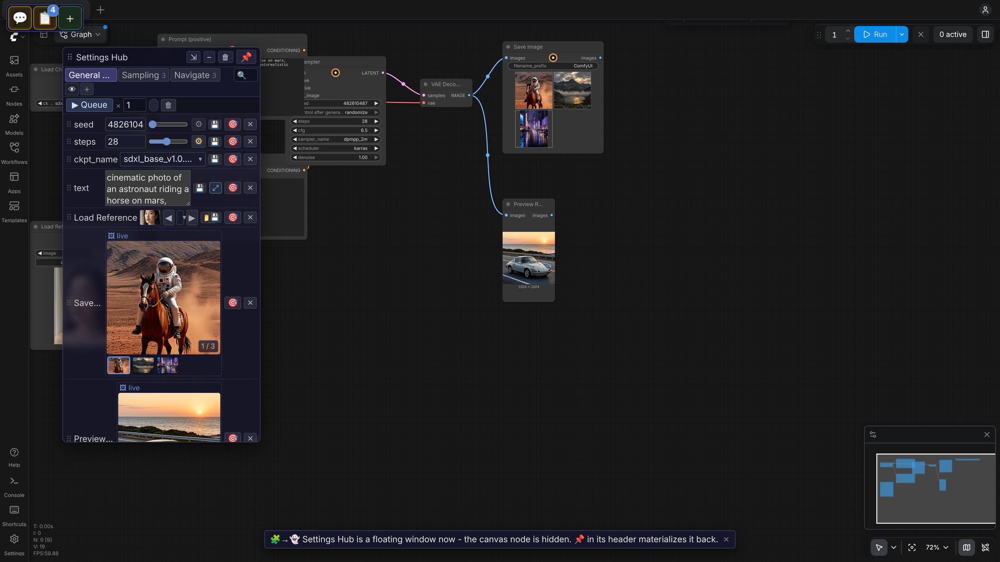

### Виртуальные хабы (v90)

Хабы без ноды на канве — сколько угодно, под разные задачи:

- **ПКМ по канве → «＋ New virtual hub (floating, no canvas node)»** — создаёт
  виртуальный хаб: тот же полноценный SettingsHub (реальная нода на
  root-графе, канонический путь создания), но канва его полностью скрывает —
  ни отрисовки, ни попадания кликов/рамки выделения в невидимую ноду;
- вы видите только **плавающее окно** (обычный пин-режим: драг, ресайз,
  сворачивание, авто-складывание). В шапке фантома: 🗑 — удалить хаб
  (двойное подтверждение), двойной клик по заголовку — переименовать;
- **📌 материализует** хаб: флаг стирается, и та же нода со всеми пинами,
  пресетами и вкладками становится обычной видимой нодой на канве — «нодный
  путь» остаётся как был;
- фант**живёт в воркфлоу** (`properties.hubConfig.phantom`): переживает
  перезагрузку страницы (окно само ре-флоатит через обычный пин-путь), при
  смене воркфлоу окно чужого фантома закрывается, при возврате — открывается.

Переименовать виртуальный хаб можно двойным кликом по заголовку окна или
через ПКМ по окну → «✏ Rename hub» (v93; в v94 починено применение, в v95
попап переименования больше не прячется под окном).

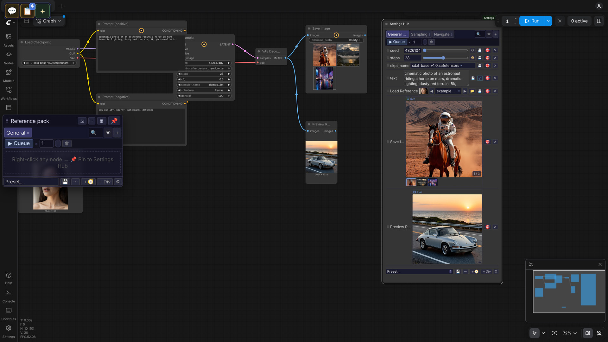

### Размер шрифта интерфейса (v90)

Одна настройка на все три утилиты: ⚙ в хабе, ⚙ стака и ⚙ чата содержат
одинаковую строку **«Font size (hub · stack · chat)»** (80–200% быстрые
кнопки, свои значения 75–250% тоже честно применяются). Реализация — CSS-переменная
`--sh-fs` на `:root`: весь текст и геометрия текстовых контролов в
styles.css идут через `calc(var(--sh-fs, 1) * Npx)`, поэтому 100% выглядит
как раньше пиксель-в-пиксель, а 150%+ **перевёрстывается, а не ломается**:
строки переносятся (вкладки — с переносом), длинные значения сокращаются
многоточием с тултипом, селекты и числовые поля масштабируют свою ширину,
списки и панели скроллятся. Миниатюры медиа и размеры панелей остаются прежними.

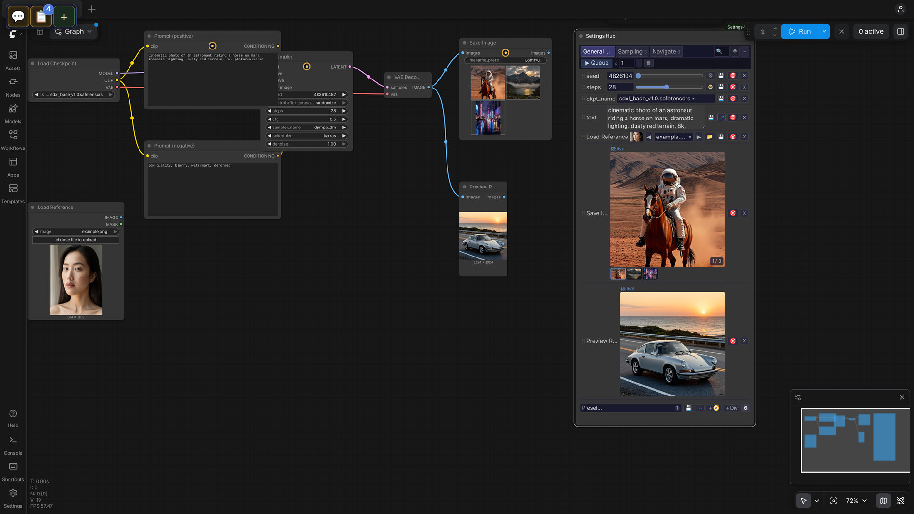

### Минипанель (v91)

Тонкая **панель задач** с кнопками Chat / Stack / Workflows (v101) / ＋ Hub:
тумблеры включают и выключают соответствующие панели, клик по активной кнопке
сворачивает панель в минипанель (и возвращает обратно), «＋ Hub» создаёт
виртуальный хаб. На кнопках живут **бейджи** (число записей стака, статус
чата, число открытых вкладок Workflows с янтарной точкой при несохранённой
работе); саму минипанель можно перетащить за любой край (v93). Включается в
родных настройках ComfyUI: Settings → SettingsHub → «Mini panel» — поэтому
доступна в любом воркфлоу, даже там, где ноды-хаба нет. Свёрнутые в
минипанель панели помечены янтарной точкой.

### Панели не мешают окнам ComfyUI (v90)

Когда открыт любой модальный диалог ComfyUI (настройки, загрузка воркфлоу и
т.п.) или нативный `<dialog>`, все плавающие слои SettingsHub (хабы, стак,
чат, compare, меню, попапы, вьюверы, тосты) **автоматически убираются с
экрана** (visibility + pointer-events, геометрия не обнуляется) и возвращаются
в момент закрытия окна — настройки Comfy больше никогда не перекрыты и не
блокированы. Наблюдатель событийный (MutationObserver) с запасным сканом
400 мс.

### Точки навигации

Быстрое перемещение по большим воркфлоу (включая вложенные subgraphs):

- **＋🧭** в тулбаре хаба — режим прицела: клик по канве ставит точку
  (Esc/ПКМ — отмена); либо пункт «🧭 Add navigation point here» в ПКМ-меню
  канвы;
- маркеры точек рисуются на канве и **перетаскиваются**;
- строка точки: прыжок, бейдж зума, ⌨-чип хоткея, поповер с координатами;
- прыжок ставит точку к **левому-верхнему углу вью** (отступ 80px) с
  антидрейф-камерой: абсолютная постановка со самопроверкой конвертером,
  эмпирическим пробником и settle-гвардом — прыжок одинаково точен на любом
  фронтенде (анимации входа в подграф, DPR-прослойки, «лживые» конвертеры);
- цели резолвятся по **uuid сабграфов** (двухпроходный BFS): точка переживает
  save/load и шеринг воркфлоу, а «сироты» честно помечаются ⚠;
- **v69:** при создании точки фиксируется **текущий зум канвы** — «custom zoom»
  включён по умолчанию, прыжок восстанавливает ровно тот вид, который был у
  вас перед созданием точки («= now» перекалибровывает вручную).

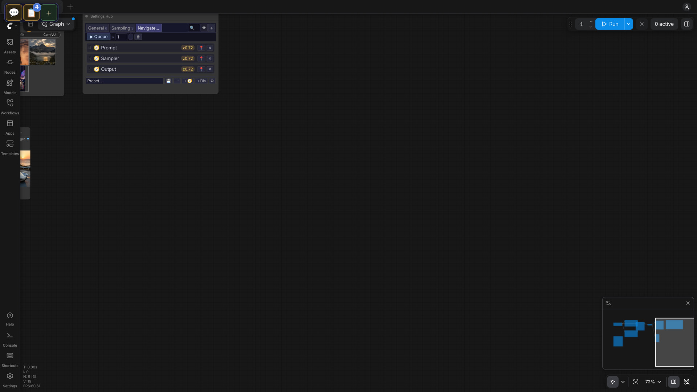

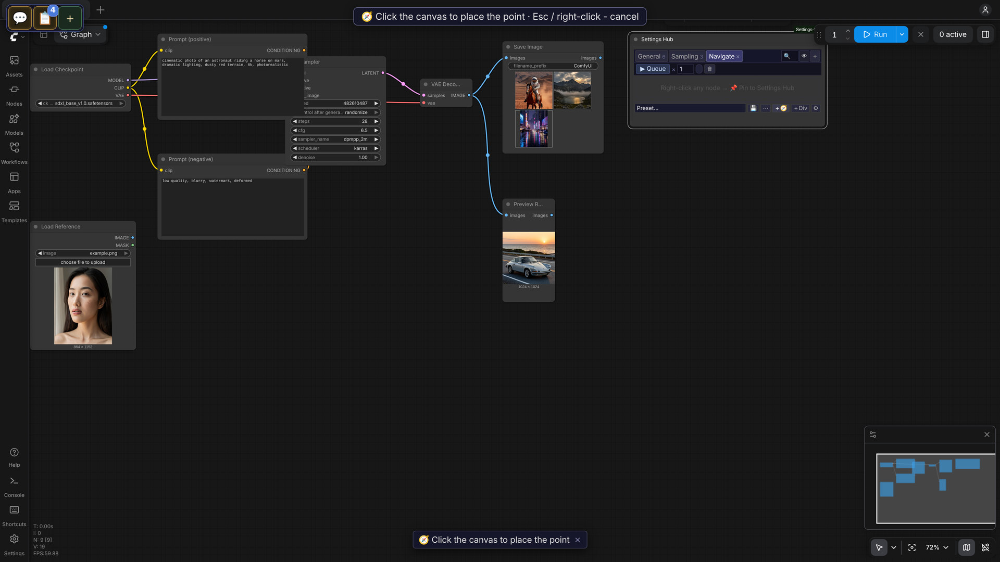

Поповер точки: координаты (read-only), «custom zoom» с полем и «= now»,
кнопка ▶ jump для проверки.

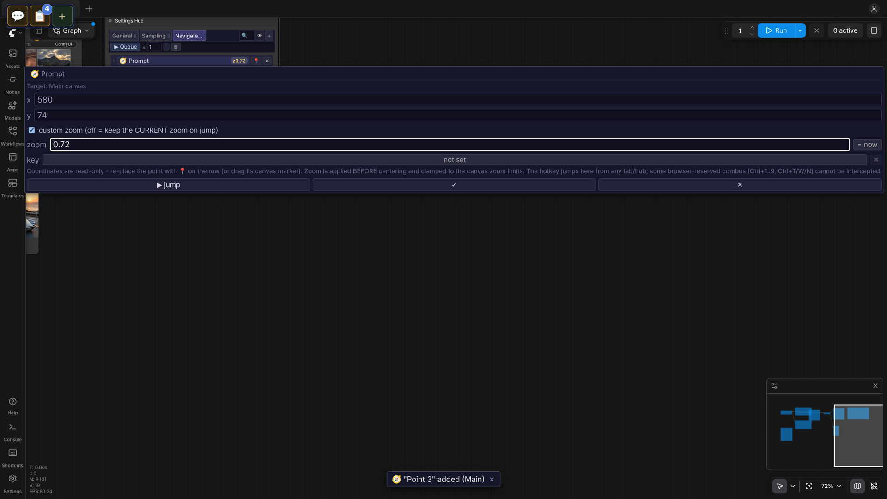

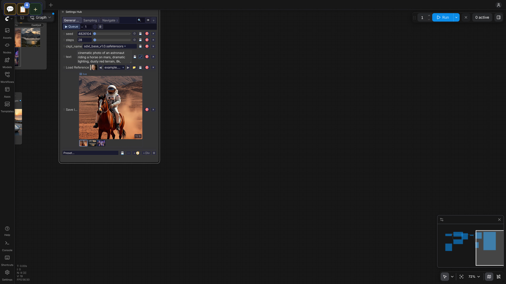

### Горячие клавиши точек

Каждой точке можно назначить **сочетание клавиш** (одиночная клавиша или
Ctrl/Alt/Shift/Meta+клавиша). Канонизация идёт по **физической клавише**
(`e.code`): назначение переживает смену раскладки — назначили Ctrl+G в EN,
нажимаете ту же клавишу в RU, точка прыгает. Дубликаты отклоняются с именем
точки-владельца; сработавший прыжок показывает тост. Движок — один
document-capture слушатель с гвард-цепочкой (поля ввода, e.repeat,
modifier-only не перехватываются; несовпадение оставляет событие полностью
родному обработчику). Часть комбинаций браузер резервирует (Ctrl+1..9,
Ctrl+T/W/N) — они неперехватываемы.

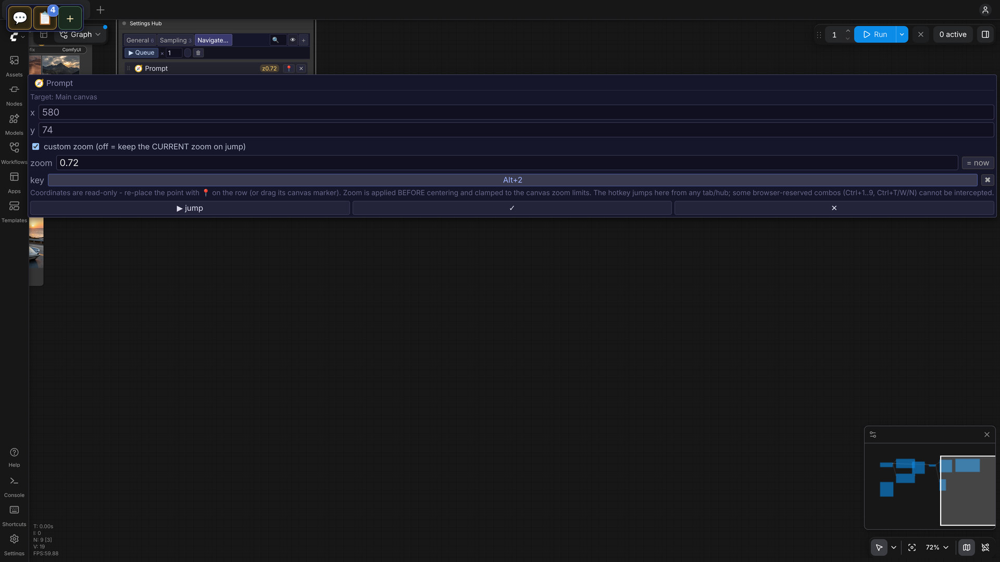

### Paste Stack

**Отдельная плавающая панель-история буфера обмена** (не вкладка хаба — хаб и
стек работают одновременно). Захват:

- клик по зоне «＋ Click or Ctrl+V» — чтение буфера через Clipboard API, а
  когда браузер не может (LAN-http или файлы из Проводника) — автоматически
  **OS-хелпер**: ComfyUI-процесс читает буфер ОС по запросу
  (`POST /settings_hub/clipboard`, только loopback + кастомный заголовок,
  ≤10 файлов / 25 МБ / 60 МБ, никаких фоновых опросов);
- `Ctrl+V` при наведении на панель;
- **drag&drop файлов из Проводника** — любые виды (видео/аудио/текст/бинарные).

**Скопированные ноды с группами (v96)** — стек хранит фрагменты графа и
вставляет их в любой воркфлоу (копирование между разными рабочими
процессами):

- **автозахват**: каждый `Ctrl+C` на графе попадает в стак (тумблер
  ⚙ стека «Capture canvas copies (nodes)», по умолчанию ВКЛ; повторное
  копирование того же выделения поднимает существующую карточку наверх, а не
  плодит дубли);
- **вручную**: кнопка **⧩** в тулбаре панели кладёт в стек ТЕКУЩЕЕ выделение
  канваса независимо от тумблера;
- **карточка 🧩 (v99/v100 — компактная и информативная)**: три строки — название
  (имя пользователя > реальное имя ноды > название группы > характерные
  типы) + счётчик нод; РЕАЛЬНЫЕ ТИПЫ нод со счётчиками (`KSampler ×3 · CLIP
  ×2 · +4 types` — все типы при ≤5 нодах, топ-3 + «+N types» дальше);
  группы · связи (только когда счёт достоверен — «неизвестно» не
  подменяется нулём) · размер · дата. Высота карточки НЕ зависит от размера
  графа, миниатюр графа нет. Превью живёт в метаданных `nodeMeta`
  (схема 1: nodeCount / linkCount / groupCount / топ типов / группы с
  цветами / singleTitle), вычисляется ОДИН раз при захвате, хранится на
  сервере (белый список + лимиты 32 типа/32 группы, НЕ входит в content
  hash, обновляется при повторном копировании того же фрагмента) и лениво
  добирается/ДОПОЛНЯЕТСЯ PATCH-ом для старых записей (в т.ч. файловых >100 КБ;
  v100: агрегаты v99 без счётчика связей чинятся одним тихим re-parse+PATCH);
- `[→🧩]` — вставка в ТЕКУЩИЙ воркфлоу (фрагмент подменяется в канвас-буфер
  `litegrapheditor_clipboard` на время одного нативного
  `canvas.pasteFromClipboard()` — возвращаются ноды, провода, значения
  виджетов, ГРУППОВЫЕ БОКСЫ, рерауты и подграфы ровно в том виде, как их
  скопировала эта версия ComfyUI; работает и на новом, и на старом litegraph);
- **🔍 инспектор (v99/v100) — Overview | Nodes | Groups | Connections | JSON**:
  Overview — блоки статистики (ноды/типы/группы/связи), распределение по
  типам, группы с цветами и составом; Nodes — поиск по названию/типу
  (v100: фокус и каретка не теряются между нажатиями), список ПОРЦИЯМИ
  (60 строк + «Show more» по 150 — сотни нод не создают гигантский DOM),
  клик по ноде разворачивает ВХОДЫ/ВЫХОДЫ/ЗНАЧЕНИЯ ВИДЖЕТОВ/properties/
  соседей (длинные тексты свёрнуты с кнопкой копирования, детали строятся
  лениво и кешируются); Groups — цвет, число нод (только достоверное, по
  bounding-боксу, v100: одноимённые группы больше не задваивают состав) и
  состав; Connections — «источник → выход → приёмник → вход», только
  достоверные строки; **v100 — связи читаются из ЛЮБОЙ реальной формы
  канвас-буфера**: TS-сборка пишет объекты
  `{id, origin_id, origin_slot, target_id, target_slot, type, ...}`
  (слежка в `inputs[].link: null`), легаси-сборка — относительные
  5-кортежи `[origin_rel, origin_slot, target_rel, target_slot, origin_id?]`
  (null у источника = он не был выделен), workflow-дамп — 6-кортежи;
  конечная точка вне выделения честно показывается как «(external)», а
  неизвестная форма по-прежнему даёт извинение, не ноль; JSON — сырой
  источник свёрнут, превью ограничено, [📋] копирует ПОЛНЫЙ JSON;
- **[📋]** — копирование исходного JSON в системный буфер (всегда полный);
- **drag на канвас**: карточку нод можно перетащить прямо на граф —
  перекрестие показывает точку, и вставка произойдёт В НЕЙ;
- фильтр типа «Nod» в тулбаре.

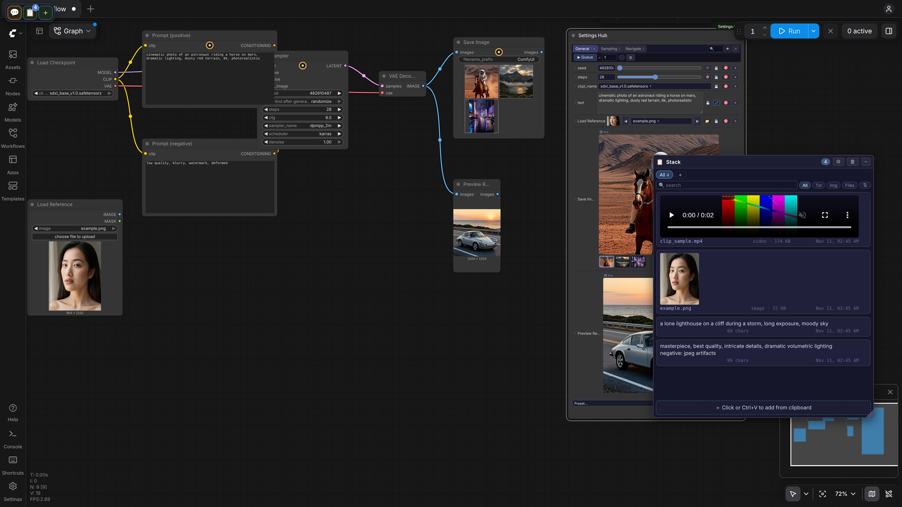

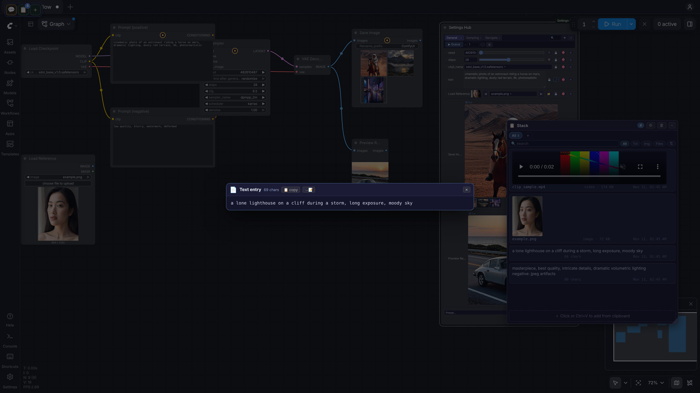

Карточки: текст (превью + copy-back кликом), картинки (превью + возврат в
буфер), видео/аудио (плеер), файлы. Действия: `[→ медиа-строка]` — отправить в
первую подходящую медиа-строку хаба, `[⤓]` скачать.

**Drag прямо на ноды графа (v74 — любые виды карточек):** картинку — на
Load Image / маски, видео — на загрузчики видео (VHS «Load Video», нативный
LoadVideo), аудио — на LoadAudio, текст — на любые ноды с текстовыми полями
(CLIP Text Encode и др. — запись в строковый виджет под курсором). Нода
подсвечивается (зелёный — медиа, синий — текст), `Esc` — отмена; загрузка
через `/upload/image` и запись в combo.

Сниппеты (v72): 📌 **пины переживают вытеснение**, ✎ переименование и теги
(Enter — сохранить, Esc — отмена), поиск и фильтры типа, счётчик использований
×N, и **«→📝 в строку»** — вставка текста в последнее сфокусированное
текстовое поле хаба (или drag карточки прямо на зеркало).

**Редактирование — для ЛЮБОЙ карточки (v97):** кнопка ✎ (имя / теги /
вкладка) раньше открывалась только у текстовых записей — у картинок,
видео, аудио, файлов и фрагментов нод она ничего не делала. Теперь
инлайн-редактор открывается у ВСЕХ видов карточек: дайте картинке имя
(«my render»), теги («render, hero») или переложите фрагмент нод в
другую вкладку — так же Enter/Esc, так же поиск и фильтр по тегам.

**🗑 Очистить весь стек — кнопка в шапке самой панели** (второй клик
подтверждает). Список карточек полноценно скроллится с подсвеченным
скроллбаром.

**Крестика в панели нет (v75)** — свернуть можно кнопкой [–]: с v91 панель
сворачивается В МИНИПАНЕЛЬ (маленькая перемещаемая плашка с кнопками
Chat/Stack, тумблерами вкл/выкл и кнопкой «＋ Hub»; янтарная пометка = панель
свернута в неё, клик возвращает). Полностью убрать панель можно через её
настройки: ⚙ в ШАПКЕ САМОЙ ПАНЕЛИ → «Stack panel: Off» — вернуть: минипанель
(тумблер 📋) или родной диалог ComfyUI (Settings → SettingsHub → «Mini
panel» + переключатели элементов), он доступен в ЛЮБОМ воркфлоу, даже где
ноды-хаба нет.

**Самодиагностика хранилища (v76):** при старте панель пробирует
`GET /settings_hub/stack/health` и вместо безликой надписи «storage
unreachable» называет точную причину: у сервера нет роутов стека (старый
py/ — обновите ВЕСЬ пак и перезапустите ComfyUI), нет связи, HTTP-код,
папка хранилища не записываема, либо версии web↔py не совпадают
(недоустановленный пак). Если хранилище работает, а py старше v76 —
зелёная заметка «storage works». Кнопка **[↻ check again]** повторяет
пробу и ресинк без перезагрузки страницы.

**Тихие зелёные заметки (v78):** зелёные вердикты «storage works»
(legacy/mismatch — хранилище РАБОТАЕТ, аварии нет) показываются **один
раз на состояние** и дальше не мозолят глаза: первый показ запоминается
в localStorage (`settingshub.stack.noteSeen`), на следующих загрузках
страницы заметка не появляется (одна строка в console.info вместо неё),
а ✕ на заметке гасит её сразу. Красные состояния (нет роутов / нет
связи / HTTP / папка не записываема) видны всегда — это реальные
проблемы. После установки ПОЛНОГО пака и перезапуска ComfyUI заметки
исчезают сами: версии web↔py совпадают, панель молчит.

**Настройки стака — в самой панели (v88):** ⚙ в шапке панели открывает её
собственный попап — Panel On/Off, лимит записей (25–500) и «Storage
folder» (v84) с контрактом Enter/Esc. ⚙ хаба секцию Stack больше не
содержит. Начиная с v101 настройки «Stack scope» в попапе НЕТ — обоими
хранилищами управляет тогглер в шапке панели.

**Два хранилища сразу + тогглер в шапке (v101):** глобальный стек и
хранилище текущего воркфлоу существуют ОДНОВРЕМЕННО — никакого режима,
который прячет одно из них, больше нет. В шапке панели двухсегментный
переключатель `[🌐 | @wf]`: активный сегмент подсвечен, клик мгновенно
переключает хранилище, которое показывает панель (полный ремоунт с
перечитыванием списка; состояние переживает перезагрузку страницы —
localStorage `settingshub.stack.scope`):

- **🌐 Shared** — один стек для всех воркфлоу, записи лежат на сервере в
  `user/settings_hub/stack/`;
- **@wf Per-workflow** — у каждого воркфлоу свой стек: идентификатор
  привязки хранится В САМОМ ФАЙЛЕ воркфлоу
  (`extra_data.settingshubStackId` — «стек сохраняется в воркфлоу»),
  записи лежат на сервере в
  `user/settings_hub/stack/workflows/<id>/`, а 🗑 чистит только активное
  хранилище. Текстовые сниппеты дополнительно зеркалируются в файл
  воркфлоу и **восстанавливаются автоматически**, если серверное
  хранилище этого воркфлоу пусто (воркфлоу перенесли на другую машину /
  почистили папку user).

Переключение НИКОГДА не переносит записи (AGENTS.md 5.1 правило 7) —
каждое хранилище держит своё: общее хранит общие записи, воркфлоу —
свои, и они не смешиваются ни при переключении, ни при смене воркфлоу.

**Вкладки (v79) — группировка под задачи:** под шапкой панели таб-бар
`[All (n)] [Задача А (n)] [＋]`. **All** — сводный вид (всё как раньше,
по умолчанию). Новая запись (Ctrl+V / клик / файлы) попадает в ОТКРЫТУЮ
вкладку; на All — остаётся без группы. Перенос: перетащите карточку на
чип вкладки (на All — убрать из группы) или поле «tab» в редакторе
карточки (✎). Двойной клик по чипу — переименование (записи
перепатчатся; переименование в существующую вкладку — слияние), ✕ на
чипе — удалить вкладку (записи НЕ удаляются — возвращаются в All),
подтверждение как у 🗑. 🗑 чистит АКТИВНЫЙ вид: на вкладке — только её
записи, на All — весь стек. Порядок вкладок — по созданию, помнится
на каждый scope отдельно (localStorage `settingshub.stack.tabs`);
пустая вкладка существует, пока не удалена. Операции с вкладками
никогда не удаляют записи (AGENTS.md 5.1 правило 9).

**Скролл вкладок колесом (v97):** когда вкладок много и чипы не
влезают в ширину панели, полоска вкладок скроллится ГОРИЗОНТАЛЬНО
КОЛЕСОМ МЫШИ (вертикальное вращение ведёт скроллЛефт; тачпад с
горизонтальной осью — тоже). Скроллбар спрятан — панель остаётся
чистой; событие перехватывается только когда полоска реально
переполнена. Открытая вкладка всегда доворачивается в видимую зону
(в т.ч. после переименования и подтверждения удаления).

**Просмотр полного текста (v79) с редактором (v97):** у текстовых карточек
кнопка 🔍 — оверлей с ПОЛНЫМ текстом записи (длинные промпты с одинаковым
началом больше не выглядят дубликатами), кнопки 📋 copy и →📝 вставка,
закрытие по Esc / ✕ / клику вне. **Редактирование текста (v97):** кнопка
«✎ edit» превращает просмотр в textarea — правьте промпт целиком;
«✓ save» сохраняет через PATCH `{text}` (сервер хранит новый текст, размер
и хэш следуют за содержимым — дедупликация остаётся честной; тексты
больше 100 КБ прозрачно переезжают в .txt-блоб, файловые переписываются
на месте), Esc сначала отменяет правку (возврат к просмотру), второй Esc
закрывает оверлей; Ctrl+Enter — сохранить. Пустой текст сохранить нельзя
(удаляйте карточку её ✕).

**Большой просмотр медиа (v83):** 🔍 есть теперь у КАЖДОЙ нетекстовой
карточки — картинок, видео, аудио и файлов (мелкая миниатюра не давала
рассмотреть детали):

- **картинка** — большое вписанное в экран превью: **колесо мыши — зум**
  (0.2×–8×, точка под курсором остаётся на месте), **перетаскивание —
  панорамирование**, **двойной клик — переключение 1:1 ↔ вписать**; в
  шапке после декодирования появляются реальные размеры (832×1216);
- **видео** — большой плеер (controls, автоплей без звука — иначе
  браузеры блокируют), вместо миниатюрного;
- **аудио** — крупный блок с плеером;
- **файл** — текстовые форматы (txt/md/json/csv/log/xml/yml/yaml/ini/tsv)
  показывают содержимое ПРЯМО В ОВЕРЛЕЕ (первая сессия берёт blob, затем
  серверный роут; первые 300 КБ с пометкой об усечении; 📋 копирует
  показанный текст), бинарные честно пишут «нет встроенного просмотра» и
  предлагают ⤓ скачать.

Закрытие — Esc / ✕ / клик мимо карточки. У текстовых карточек 🔍 как и
раньше открывает полноэкранный просмотр текста (v79).

**Move mode (v80) — сортировка стека:** кнопка ⇅ в тулбаре панели
(рядом с фильтрами) включает режим перемещения: каждая карточка
(включая файловые, у которых нет обычного drag) становится ручкой —
тяни и расставляй свой порядок. Зелёная полоска показывает, куда
карточка ляжет (вниз — под карточку под курсором, вверх — над ней);
у длинного списка работает автоскролл у краёв. В режиме сортировки
обычные drag-цели отключены (ноды/зеркала/чипы вкладок — случайно не
загрузить и не перегруппировать), простой клик по карточке ничего не
делает (мелкие кнопки — 📌/✎/✕/🔍 — работают). Порядок хранится на
сервере (`POST /settings_hub/stack/reorder`): внутри вкладки двигается
именно пара «тащу/цель», остальные виды не меняются; записи никогда
не теряются — неупомянутые в запросе дописываются в конец
(AGENTS.md 5.1 правило 10). Режим — временное состояние редактирования:
после перезагрузки страницы всегда выключен. На старом py (без
/reorder) новый порядок живёт до перезагрузки страницы, в консоли
одна поясняющая строка.

**Хранение — на сервере ComfyUI** (`user/default/settings_hub/stack/`,
index.json + items/): стек портабелен (переезжает вместе с папкой ComfyUI),
общий для localhost/127.0.0.1/LAN и любых браузеров, переживает очистку
site-data. Лимиты настраиваются в ⚙ → Stack (по умолчанию 100 записей,
серверные потолки 500 / 200 МБ). Если роуты недоступны (обновили без
перезапуска ComfyUI) — панель работает в режиме сессии и честно об этом
пишет.

**Свой путь хранения (v84):** папка по умолчанию остаётся
`user/settings_hub/stack`, но теперь её можно переназначить: ⚙ → Stack →
«Storage folder» — введите **абсолютный** путь (например `D:\gen\stack` или
`/home/me/comfy_stack`) и нажмите Enter; чип `default` возвращает папку по
умолчанию. Сервер ДО переключения создаёт папку и проверяет запись
(относительные пути и папки без записи отвергаются — хранилище никогда не
остаётся «наполовину переехавшим»), затем помнит выбор между перезапусками:
он хранится в `user/settings_hub/stack_root.json` — всегда в стандартной
папке user, поэтому даже сломанный кастомный путь не может спрятать дорогу
назад. Все роуты стека следуют активному корню — общий стек, per-workflow
сторы (`workflows/<id>/`), health, раздача файлов; у `GET
/settings_hub/stack/health` появилось поле `custom`. Смена папки **никогда
не переносит записи**: новое место начинается пустым, старое хранит свои
файлы (при необходимости скопируйте/перенесите их сами при остановленном
ComfyUI). Под полем настроек строка показывает, какая папка активна прямо
сейчас; отказ сервера (относительный путь / нет записи) показывается там же.

**Одна лупа на карточку и «не теряться» при узком окне (v85):** у карточек
стака снова ровно одна 🔍 — ветки текста/видео/аудио/файлов добавляли вторую
рядом с базовой (у изображений она всегда была одна; тултип остался
типовым — у текста «Full text view»). Панель стака больше не пропадает за
краем окна: при загрузке и при каждом изменении размера окна сохранённые
ширина/высота обрезаются до вьюпорта, а x/y пере-клэмпятся — панель
полностью возвращается в окно (если не влезает вовсе — остаётся видимый
край 64px, как при перетаскивании; минимизированный чип пере-клэмпится так
же). Уменьшенный размер не запоминается — когда окно снова увеличивается,
возвращаются сохранённые w/h; позиция persist'ится с дебаунсом 150 мс.

> ⚠ Clipboard API браузера доступен только на localhost/https — на LAN-http
> работают Ctrl+V, drag&drop и OS-хелпер (клик по зоне paste тоже сработает —
> через хелпер).

### Image Compare

ПКМ на **медиа-строке**, **миниатюре галереи** или **карточке стека** →
«Add to Compare»: первое добавление занимает слот **A**, второе — **B**,
дальнейшие сдвигают очередь; есть явные «→ A» / «→ B», свап и очистка слотов.
Режимы:

| Режим | Как работает |
| --- | --- |
| **Wipe** | перетаскиваемая шторка (или клик по сцене) — A слева, B справа |
| **Fade** | слайдер кроссфейда B поверх A (0–100%) |
| **Blink** | клик по сцене мигает A↔B |
| **Diff** | пиксельная разница \|A−B\| × gain 1–10× |

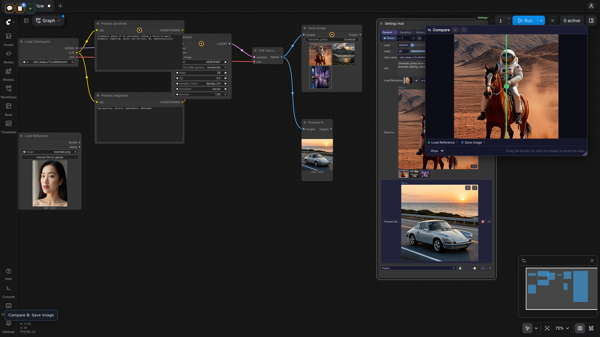

Сравнение **обновляется само после каждого рана** (панель перечитает
источники по событию `executed`) — удобно для A/B-тестирования промптов и
семплеров: поменялся файл у загрузчика — картинка в сравнении подменилась.
Позиция, размер, режим, gain и позиция шторки запоминаются.

**v83 — исправление «картинки не отображаются»:** до v83 панель показывала
только подписи слотов A/B — JS переключал видимость значением `display: ""`,
которое лишь снимает inline-стиль и возвращает элемент под власть таблицы
стилей, где у `.hub-cmp-slot` / `.hub-cmp-divider` / `.hub-cmp-canvas`
стоит дефолт `display: none`. В реальном браузере слоты, шторка Wipe и
холст Diff были невидимы всегда (тесты проверяли `!== "none"` и пропускали
баг). Теперь видимость переключается явными `block`/`none` (контракт
закреплён тестами), под сценой появилась строка натуральных размеров
«A 832×1216 · B 1024×1024» — удобно для пар с разным разрешением, а режим
Diff прямо в подсказке говорит, что B масштабируется в кадр A.

### LLM Chat

Плавающее окно чата с нейросетью — по образцу стака: перетаскивание за шапку,
ресайз, сворачивание в чип, «не теряется» при сужении окна. Ключевое:

- **Вкладки-чаты.** Каждая вкладка — отдельный независимый диалог; история
  живёт на сервере в `user\settings_hub\chat\` (переживает перезагрузки,
  общая для всех браузеров, едет с папкой ComfyUI). 🕘 — открыть/удалить
  сохранённый чат, двойной клик по вкладке — переименовать, 🗑 — очистить
  текущий чат (двойное подтверждение).
- **Массовое управление чатами (v108):** в 🕘 «Saved chats» у каждой строки
  появился чекбокс, а над списком — ряд **Select all / Deselect all** (одна
  динамическая кнопка по образцу формы сохранения пресетов: есть хоть одна
  невыбранная → «Select all»), **🗑 Delete selected** и **🗑 Delete all**.
  Оба удаления подтверждаются вторым кликом (кнопка пульсирует 2.6 с),
  запрос идёт одним POST `/chat/sessions/delete` (`{ids:[...]}` или
  `{all:true}`) — одна блокировка на сервере, папки вложений умирают вместе
  с чатом; открытые вкладки удалённых чатов закрываются, а при полном
  опустошении автоматически создаётся свежая вкладка.
- **Скролл вкладок колесом (v98):** когда вкладок много и чипы не помещаются
  в полоску, она скроллится колесом мыши (скроллбар скрыт — как в стеке v97):
  вертикальная дельта ведёт прокрутку (учитываются режимы «строки» и
  «страницы», тачпадная горизонтальная дельта выигрывает), событие
  поглощается только когда полоска реально переполнена; после каждого
  ререндера открытая вкладка доворачивается в видимую зону.
- **Один формат подключения:** OpenAI-совместимый URL + ключ (необязательно).
  Основной сценарий — локальный PolyStrata-сервер (`http://127.0.0.1:8080/v1`),
  тот же формат понимают llama.cpp, LM Studio, Ollama (/v1), vLLM, OpenRouter.
  Кнопка **[Test]** в настройках чата проверяет связь и тянет список моделей.
- **Тулбар под полем ввода (v87):** дропдаун модели (список с LLM-сервера,
  ↻ обновляет), выбор режима думания (default/off/low/medium/high), кнопка 📜
  системного промпта и кнопка ⚡ GPU & память — всё всегда «под рукой».
- **Полный список моделей (v88):** дропдаун читает `/api/models` — реестр
  PolyStrata со ВСЕМИ установленными моделями и их статусами (как это делают
  ноды PolyStrata; «битые» конфиги скрыты), для остальных серверов — обычный
  `/v1/models`, в крайнем случае текущая модель из `/v1/status`. Варианты
  помечены: ● загружена/выбрана, ◐ грузится, ○ доступна; выбор ещё НЕ
  загруженной модели реестра ПЕРЕКЛЮЧАЕТ сервер (`/api/models/load`, может
  занять минуты; для простых llama.cpp — фолбэк `/v1/load`).
- **Системный промпт (v88) — ВАШ каталог:** выдуманных пресетов больше нет.
  📜 показывает .txt-файлы из `ComfyUI\models\LLM\prompts` — ТОТ ЖЕ путь,
  что сканируют ноды PolyStrata / llama.cpp (включая подкаталоги), с кнопкой
  [↻] обновления списка и живым поиском по нескольким словам (каждое слово
  должно встретиться в относительном пути). Клик по файлу выбирает его
  (`prompt_preset`), сервер читает файл ЗАНОВО перед каждым сообщением и
  выбранный файл имеет приоритет над кастомным текстом — семантика нод.
  «none (custom text)» + поле + Save/Clear остаются для своего текста.
- **Свой путь промптов (v89):** ⚙ → секция «System prompt catalog» → поле
  «Prompts folder» — любая своя папка (абсолютный или относительный путь);
  [default] возвращает `models\LLM\prompts`. Каталог остаётся read-only:
  листинг и чтение файла перед каждым сообщением идут из вашей папки.
- **Поля настроек с именами (v89):** в ⚙ каждое число подписано видимой
  меткой (temperature, top_p, max tokens, history depth, media depth,
  image max side, images/msg, video frames, video max side, timeout, context
  size) — полное объяснение остаётся в тултипе.
- **Занятый/доступный контекст (v89):** в статус-строке — «ctx 3.2k/32k»:
  занято = точные `usage.prompt_tokens` от сервера (без «≈») либо оценка
  прокси (chars/4 + 8/сообщение + 750/картинка, с «≈»); доступно = поле
  «context size» в ⚙ (0 = авто: PolyStrata /v1/status context.native).
  «⚠» — занято больше 90%: модель начинает забывать старые сообщения.
- **Поиск по сохранённым чатам (v89):** в 🕘 строка живого поиска — мульти-
  слова, каждое слово должно встретиться в НАЗВАНИИ чата, в СОДЕРЖАНИИ или
  в обоих (вместе); под названием совпавшего чата показывается строка
  содержания с совпадением.
- **GPU & память (v87):** по кнопке ⚡ — статус модели (загружена/свободно
  VRAM), **резерв VRAM для ComfyUI** (механика PolyStrata `/v1/vram`: сервер
  держит N MiB видеопамяти свободными и сам пере-применяет резерв после
  перезапуска движка; прокси синхронизирует `EXTRA_RESERVED_VRAM` ComfyUI с
  фактическим потреблением LLM — ComfyUI планирует загрузки с учётом LLM и
  не ловит OOM; при резерве > 0 сервер прокси пере-применяет его ПЕРЕД
  каждым сообщением), **выгрузить модель** (`/v1/unload` — движок остановлен,
  вся VRAM и резерв возвращены), **загрузить сейчас** (`/v1/load`) и
  **освободить память ComfyUI** (родная механика «Free model and node
  cache»: unload_all_models + очистка torch-кэша + gc — LLM не задевается).
- **Настройки чата — в самом чате (v87/v88):** ⚙ в шапке панели открывает
  URL/ключ/[Test], сэмплинг, глубины, лимиты медиа, стриминг, срок хранения,
  таймаут и папку хранения; сверху — строка «Chat panel» On/Off (v88).
  ⚙ хаба настроек чата больше НЕ содержит вообще.
- **Картинки (vision):** 📎 / Ctrl+V / drag&drop — картинка сжимается до
  настроенной стороны и уходит в запрос как стандартная OpenAI-часть
  `image_url`. **Видео:** кадры нарезает сервер (ffmpeg) в конвенции
  PolyStrata — `[Video N]` + метки `<X.X seconds>`, модель видит
  последовательность. Текстовые файлы входят в запрос содержимым (до 300 КБ).
- **Стриминг и отмена:** ответ печатается по мере генерации; ⏹ прерывает —
  сервер заметит пропавшего клиента, отменит запрос к модели (PolyStrata
  освободит слот) и сохранит частичный ответ с пометкой «stopped».
- **Ответы:** упрощённый markdown (блоки кода с копированием, жирный/курсив,
  ссылки), блок размышлений 💭 у думающих моделей свёрнут; кнопки 📋 копия,
  ↻ перегенерация, ✎ правка своего сообщения с переотправкой (хвост после
  него срезается).
- **Приватность:** браузер ходит к LLM **только через ComfyUI**
  (`py/chat_proxy.py`) — на LLM-сервере не надо настраивать CORS, API-ключ; v108 — POST /chat/sessions/delete: массовое удаление диалогов {ids:[...]} или {all:true} (валидация _SID_RE, кап 1000, одна блокировка, папки вложений умирают вместе с сессией)
  лежит лишь в `config.json` на сервере (в браузере — маска), история и
  вложения тоже там. Своя папка хранения — абсолютным путём, как у стака (v84).
- **Не агент:** чат не трогает очередь, воркфлоу и ноды — чисто общение
  (интеграции с ComfyUI отложены по решению владельца).

> **Настройки чата (v88)** — целиком в самой панели: ⚙ в её шапке (Panel
> On/Off, URL/ключ/[Test], сэмплинг, глубины, лимиты медиа, стриминг, срок
> хранения, таймаут, папка хранения; v89: подписи у всех полей + «context
> size» + «Prompts folder») и тулбар под вводом
> (модель/думание/промпт/GPU). Тот же переключатель зарегистрирован в
> минипанели (Settings → SettingsHub → «Mini panel (SettingsHub)» + тумблер
> Chat), поэтому скрытую панель можно вернуть из ЛЮБОГО воркфлоу — хаб для
> этого не нужен (крестика у панели нет — контракт стака v75); v89: при
> скрытии чат и стак сами показывают подсказку, где их включить обратно;
> v91: [–] сворачивает чат в минипанель.
> Без ffmpeg видео-вложение честно пишет «недоступно».

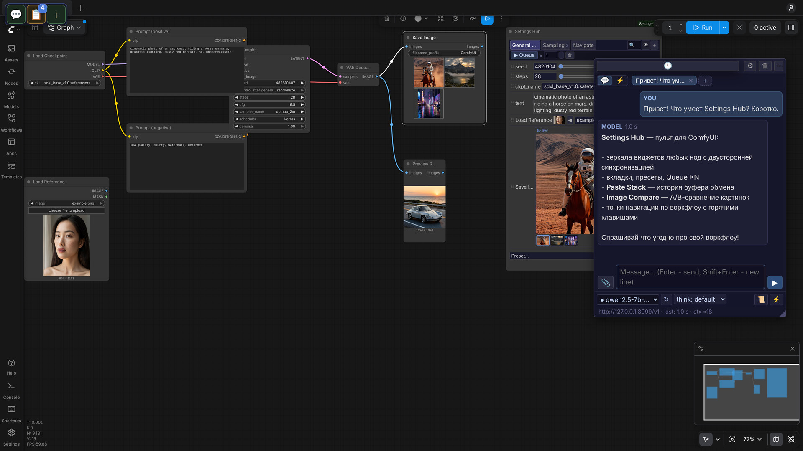

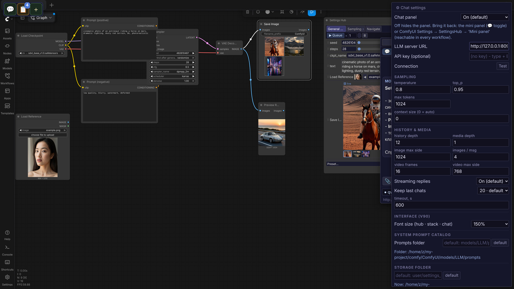

Сверх того, что описано выше:

- **Ветки чата (v91)** — ✎ правка, 🗑 удаление и fork любого сообщения
  с экспортом диалога;
- **ленивая загрузка модели (v92)** — выбор в дропдауне просто сохраняется,
  модель грузится на первом запросе; опциональная **авто-выгрузка LLM при
  старте очереди ComfyUI** (чекбокс в ⚡); рендер стрима оптимизирован
  (инкрементально + rAF), чат не лагает во время генерации;
- **режим one-shot (v93)** — одиночные запросы без истории для быстрых
  подсказок, отдельные роуты `/chat/oneshot`;
- **💭 блок размышлений** раскрывается одним кликом, в шапке виден бейдж
  активного системного промпта (v91);
- в попапе ⚡ GPU & память — **чекбоксы VRAM** (v93) вместе с резервом,
  выгрузкой/загрузкой модели и освобождением памяти ComfyUI.

### Workflows Manager

Самостоятельная утилита над **всеми открытыми воркфлоу** (v101, плавающее
окно с вкладками `Open / Presets / Files`, четвёртая кнопка минипанели — не
привязана к ноде на канве; **v108 — вкладка Files стала файл-менеджером:**
новый серверный роут `/workflows/files` отдаёт путь+РАЗМЕР+ДАТУ ИЗМЕНЕНИЯ
каждого workflow-файла (служебные presets/temp хранилища исключаются ещё на
сервере — пресеты никогда не смешиваются с обычными воркфлоу), каждая строка
показывает путь относительно корня `workflows` под именем (длинные пути
сокращаются через «…» с сохранением последних папок и имени файла, полный
путь — в тултипе), тулбар сортирует по дате/имени/размеру с переключением
возрастания/убывания, фильтрует по папке (любая глубина вложенности,
подпапки включаются), по дате изменения (от/до + быстрые периоды Today/7d/
30d), по размеру (диапазон в КБ) и по **избранному** (★ хранится на сервере
в `workflows_favorites.json` в ДЕФОЛТНОЙ папке пользователя — смена корня
хранения его не прячет; есть чип «★-only»); переключатель ≡/🌲 превращает
плоский список в ДЕРЕВО ПАПОК с раскрытием/сворачиванием любой глубины,
переходом внутрь папок и хлебными крошками (возврат в ≡ восстанавливает
привычный вид); **единое хранилище:** после переназначения папки хранения
пресеты/temp ДЕФОЛТНОГО расположения остаются доступны (чтение идёт по
ОБОИМ корням, дубликат по id разрешается в пользу активного, запись идёт
туда, где данные уже лежат — ничего не теряется и не дублируется);
v102 — шесть исправлений по фидбеку: активация
вкладки подменяет канвас через `app.loadGraphData` (v101 меняла только
подсветку таба), снапшоты temp-вкладок, которые ни разу не были активными,
⚙-попап с шириной как у стека/чата, закреплённые статус-бар и поиск Files,
фокус соседа при закрытии активной вкладки; v103 — второй раунд фидбека:
группа «🕘 Recently closed» на вкладке Files скроллится ВНУТРИ своего капа
30% (раньше 15 строк рисовали поверх «All saved workflows»), в форме
сохранения появилась кнопка **Select all / Deselect all** (одна динамическая
на два состояния), на вкладке Open — тот же мульти-словный поиск, что и на
Presets/Files (имя + путь + видимый бейдж temp, Esc очищает), маркер
ресайза стека и чата приведён к виду менеджера воркфлоу (уголок-граница с
подсветкой при наведении); v104 — **один файл на пресет** по решению
владельца: каждый пресет лежит отдельным файлом `presets/<id>.json` внутри
папки хранения (вкладок много, снапшоты temp большие, один общий файл
делал любой перенос «всё или ничего»): скопируйте один файл в `presets/`
другой машины — пресет появится при следующем чтении без экспорта/импорта,
снапшоты temp по-прежнему встроены ВНУТРЬ файла пресета, а старый общий
`presets.json` при первом обращении автоматически разделяется на отдельные
файлы (оригинал сохраняется как `presets.json.bak`, никогда не удаляется);
v105 — третий раунд фидбека: массовые закрытия переехали в одно меню
**🧹 Close ▾** (ряд кнопок снова компактный: Close ▾ / 💾 Save all / ＋ Save
preset) и в нём появилось **✕ Close all** — закрывает ВСЕ вкладки, остаются
только закреплённые 📌 (несохранённые в партии требуют второго клика);
пустая вкладка Presets после обновления страницы — лечится сама: неудачное
чтение при старте повторяется на каждом тике опроса и при каждом открытии
вкладки (вместо вводящего в заблуждение «No presets yet» — «Reading
presets…»), строка статуса показывает живую версию серверного пакета
(`srv vNNN`), а health-проба сверяет её с веб-сборкой: сервер СТАРШЕ →
красная плашка «RESTART ComfyUI» (обновление только веб-половины не
активирует новый py-код и продолжало писать общий presets.json), сервер
МОЛОЖЕ → «hard refresh»); v106 — четвёртый раунд фидбека: **подтверждения
больше не сбрасывают скролл** — вооружение 🗑 удаления (и любой другой
ре-рендер той же вкладки: одиночное ✕, Show more, поиск, Select/Deselect
all) сохраняет позицию прокрутки списка — нижний пресет больше не
«убегает» наверх перед вторым кликом (реальная смена вкладки по-прежнему
начинает сверху); **temp-вкладки открываются из 🕘 Recently closed**: при
закрытии temp-процесса его граф встраивается в запись буфера снимком
(никакого фейкового пути — клик по «Unsaved Workflow (N)» больше не даёт
404 в /userdata и мусорных путей вида «… (2).null»), изменённая сохранённая
вкладка тоже кладёт своё несохранённое состояние (переоткрытие показывает
то, что было на экране, а не старый файл на диске), пустые temp и снимки
сверх лимита размера не записываются вовсе (строка буфера всегда
что-то открывает), легаси-записи с мусорными «.null»-путями вычищаются
при старте); v107 — пятый раунд фидбека: **снимки temp-процессов переехали
на сервер**: снимок закрытой temp-вкладки больше НЕ живёт в localStorage —
сам ComfyUI и другие кастом-экстеншены раздувают ту же квоту origin, так
что встроенный снимок мог молча пропасть ровно тогда, когда он нужен
(вопрос владельца: «надежно ли твое решение?»). Кольцевой буфер 🕘 хранит
только метаданные (имя, время, путь?, tempId?), а граф при закрытии
уходит на СЕРВЕР — в зарезервированную папку `temp/` внутри папки хранения
воркфлоу (`user/settings_hub/workflows/temp/<id>.json`, один файл на
закрытый таб; папка следует за сменой корня по механике v84): переоткрытие
тянет снимок с сервера через снапшот-лестницу (v106-встраивание осталось
как фолбэк на старый py/неудачную загрузку — лимиты 400 КБ/2.5 МБ теперь
границы ТОЛЬКО фолбэка; серверный кап — 10 МБ на файл), запись покидает
кольцо (кап 15 строк, дедуп по имени) — её файл удаляется, boot-GC
вычищает сирот старше суток, на которые не ссылается ни одна запись этого
браузера (консервативно — снимок другого браузера не трогается), сервер
держит 40 новейших снимков на корень — папка ограничена даже если клиент
никогда не убирает за собой; в ⚙-попапе панели папка temp/ описана явно):

- **Пресеты рабочих наборов**: сохраните открытые вкладки как именованный
  пресет (★ избранное, `N wf`-бейдж, дата). Сохранённые вкладки кладутся как
  ссылки на файлы, **временные/несохранённые — как снимки** (snapshot),
  встроенные прямо в пресет; радио-переключатель помечает activePath.
- **▶ Switch — умный diff**: перед заменой показывается план
  («Будет закрыто X · Останется Y · Будет открыто Z» + ⚠ missing). Вкладка,
  чей файл УЖЕ открыт, не закрывается и не перезагружается; несохранённые
  защищены (keep-unsaved), 📌-замок защищает от массовых закрытий, активная
  генерация ComfyUI вызывает предупреждение. После применения — тост с
  кнопкой **↩ Undo** (восстанавливает прежний набор одним уровнем).
- **＋ Add** — дооткрывает недостающие вкладки пресета, не трогая текущие;
  **↻ Update** — обновляет пресет текущими вкладками (Overwrite / Merge с
  дедупликацией по пути).
- **Массовые действия** — меню **🧹 Close ▾**: Close saved / Close other
  saved (несохранённые, замки и активная вкладка выживают; пустые 0-node
  temp закрываются по настройке) и **✕ Close all** — все вкладки кроме
  📌 (если в партии есть несохранённые — второй клик подтверждает);
  💾 Save all modified, одиночное ✕ с двойным подтверждением для
  несохранённых.
- **Files & Recent**: кольцевой буфер 15 недавно закрытых (клик — открыть
  заново; temp-вкладки восстанавливаются из СЕРВЕРНОГО снимка
  `temp/<id>.json` в папке хранения — с v107; изменённые сохранённые —
  вместе с несохранённым состоянием), плоский
  **мульти-словный поиск** по всем сохранённым файлам
  воркфлоу, чекбоксы + «▶ Open selected» и «💾 Save selected as preset»
  (собрать пресет из файлов, не открывая их).
- **Экспорт/импорт**: ⤓ пресет или всего списка в JSON (буфер обмена),
  ⤒ импорт с генерацией свежих id при коллизиях; с v104 каждый пресет — это
  ещё и готовый файл `presets/<id>.json`: копия файла = перенос пресета.
- **⚙ панели**: On/Off, поведение (keep-unsaved, пустые temp, предупреждение
  при генерации), размер шрифта и **папка хранения пресетов** по механике
  v84: любой абсолютный путь, проверка записи ДО переключения, файл выбора
  живёт в дефолтной user-папке, смена папки НИКОГДА не переносит пресеты
  (`py/workflows_store.py`: с v104 папка `presets/` с файлом на пресет в
  `user/settings_hub/workflows` по умолчанию).
- Доступ к вкладкам — **лестница-адаптер** к `app.extensionManager.workflow`
  (стор → команды → нативный `/userdata`), при отсутствии очередной ступени
  панель деградирует с понятным тостом, ComfyUI не ломается. Первый запуск —
  **свёрнутой в панель задач**.

### Глобальные настройки

⚙ в шапке хаба — единый попап настроек:

| Секция | Что настраивается |
| --- | --- |
| **Sync** | скорость догоняющего обновления зеркал (0 = только события), звук видео (mute/volume) |
| **Previews** | задержка показа превью, «грация» скрытия, размер S/M/L/XL, автовоспроизведение |
| **Picker** | размер миниатюр пикера файлов |
| **Pin window** | тайминги авто-сворачивания плавающего окна (fold / re-open) |
| **Navigation** | маркеры точек на канве, пункт ПКМ-меню, тумблер горячих клавиш |
| **Panels (v88)** | подсказка: стак и чат — самостоятельные утилиты, их настройки и On/Off — в их собственных окнах (⚙ в шапках панелей) и в родных настройках ComfyUI (Settings → SettingsHub); секций Stack/Chat у хаба больше нет |

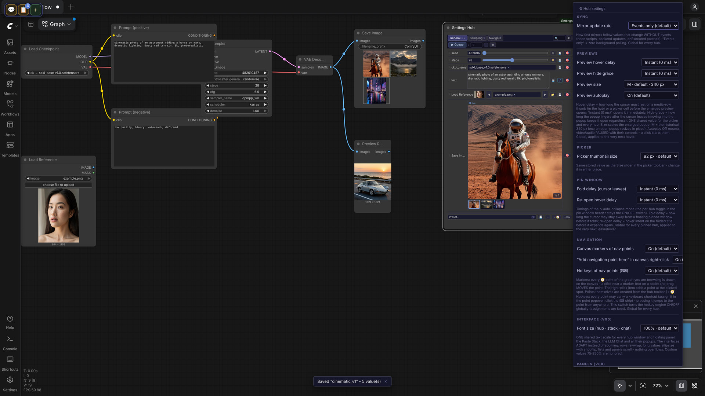

## Как это работает

- **Реактивная синхронизация без опроса.** Любой поток значений идёт через
  `writeTargetValue` под общим edit-lock'ом (`beginEdit/endEdit`), который
  подавляет эхо-обновления; DOM хаба обновляется rAF-коалисингом. Дополнительно
  можно включить догоняющий поллер в ⚙ (по умолчанию выключен).
- **Python-часть — заглушка.** `py/settings_hub.py` регистрирует ноду без
  `OUTPUT_NODE`, `noop()` возвращает `()` — узел не исполняется при постановке
  в очередь. Единственный реальный эндпоинт — `py/media_list.py`
  (`/settings_hub/list_media`), рекурсивный листинг медиа-папок.
- **Кросс-графовый резолвер.** Цели биндингов ищутся по всем живым графам
  (включая subgraphs) по id + имени; «уплывшие» заголовки чинятся
  (title-drift repair), цепочки владельцев SubgraphNode отслеживаются.
- **Классификация виджетов самолечится.** `detectWidgetType` — единственный
  источник истины; старые конфиги мигрируют на живом виджете, DOM-панели
  всегда сильнее строкового типа.
- **Жизненный цикл свежего хаба.** UI строится только у нод «в графе»;
  доставка через `onAdded` + лестницу ретраев + DOM-truth свип + финальный
  reconfigure — хаб не остаётся пустым.
- **Защита от кэша.** Точка входа штампует `__SettingsHubBuild = "v95"` до
  импортов, каждый модуль саморепортится, EXPECTED-манифест сверяет таблицу
  версий; устаревший файл из кэша браузера называется в консоли И в видимом
  баннере (Ctrl+F5), при этом регистрация fail-open — один мёртвый модуль
  не глушит остальные меню.

## Разработка и тесты

Тесты — реальные смоуки: копируют `web/*.js` в песочницу с заглушкой
ComfyUI и гоняют настоящие модули (Node ESM + jsdom).

```bash
npm i jsdom          # единственная jsdom-зависимость
node tests/smoke_nav.mjs    # движок точек навигации, камера, хоткеи, UI-путь, stack-bridge, глаз-скрытие (240 проверок)
node tests/smoke_stack.mjs  # Paste Stack: захват/дедуп/лимиты/file-режим/drag/сниппеты/скролл/clear-в-шапке/без-крестика/self-check/тихие-зелёные-заметки/вкладки+вьюер/два хранилища + тогглер 🌐/@wf в шапке (v101)/move-mode-сортировка/большой-просмотр-медиа/фрагменты нод с группами (авто+⧩ захват, →🧩 вставка, drag на канвас, вьюер)/универсальный редактор карточек/редактор текста в Full text view/скролл вкладок колесом + карточка v99 (модель именования, усечение, честные счётчики)/бэкфилл nodeMeta/инспектор Overview-Nodes-Groups-Connections-JSON/граф 500 нод порциями + связи v100 (TS-объекты/легаси-кортежи/внешние точки/фокус поиска/одноимённые группы/repair) + Image Compare (463)
node tests/smoke_menu.mjs   # регистрация меню, fail-open, баннер деградации (24)
python3 tests/py_test_clipboard.py   # OS-хелпер буфера + файловый/patch/health/reorder-роуты стека + patch text v97 + per-workflow scope + вкладки + кастомный корень v84 + nodeMeta v99 (133)
node tests/smoke_chat.mjs            # окно/вкладки/настройки/отправка/стриминг/стоп/вложения/вьюер/markdown/рефит/очистка/🕘/деградация/ctx-fill/поиск/промпт-каталог/скролл вкладок колесом v98 (172); v108: фаза SS — массовое удаление чатов в 🕘 (чекбоксы, динамический Select all / Deselect all, вооружённые Delete selected / Delete all через POST /chat/sessions/delete, закрытие открытых вкладок удалённых чатов, авто-создание свежей вкладки)
python3 tests/py_test_chat.py        # payload-сборка, сессии, вложения, прокси /send (JSON+SSE) со стаб-апстримом, one-shot (209)
node tests/smoke_workflows.mjs       # Workflows Manager: свёрнутый первый запуск + бейдж таскбара, защищённый массовый Close saved (модифицированные/temp/замки), форма сохранения (снапшоты temp, activePath, overwrite/merge), умный diff ▶ Switch + ↩ Undo, Files & Recent (буфер, мульти-словный поиск, выбор), ⚙ смена папки хранения v84, деградация, интеграция entry; v102: активация = подмена канваса через loadGraphData, снапшот никогда-не-активированной temp, открытый/закрытый/последний таб, закреплённый layout + ширина ⚙; v103: фаза WJ — recents скроллятся в капе 30%, Select/Deselect all в форме, поиск по вкладке Open (имя+путь+temp), паритет маркеров ресайза; v104: фаза WK — «один файл на пресет» в исходниках + py-контракт хранилища; v105: фаза WL — меню 🧹 Close (ряд компактнее, пункты с подписями), Close all с выжившими 📌 и вооружённым подтверждением несохранённых, автоповтор чтения пресетов (тик опроса + открытие вкладки, «Reading presets…»), srv-версия в статусе и плашка рассинхрона сервер/веб (RESTART / hard refresh); v106: фаза WM — re-рендеры одной вкладки держат якорь скролла (armed 🗑/✕, Show more, переключение вкладки сбрасывает), temp-вкладка пишется в буфер СО СНИМКОМ и без пути (на старом py — embed-фолбэк), мусор «.null» отвергается при записи и вычищается при старте, переоткрытие снимка идёт через снапшот-лестницу БЕЗ /userdata-запроса; v107: фаза WN — закрытие temp POSTит граф в /workflows/temp, кольцо в localStorage хранит ТОЛЬКО метаданные + tempId, переоткрытие тянет СЕРВЕРНЫЙ снимок (без /userdata), эвикция из кольца удаляет файл (DELETE), boot-GC убирает суточного сироту и щадит ссылочные/свежие файлы, sanitize принимает tempId-записи; v108: фаза WO — Files-ранг /workflows/files (size+mtime, settings_hub-поддерево не подмешивается), саб-строка пути+размера+даты, сортировки date/name/size ±, ★-избранное (POST files-fav + ★-only), фильтры папки/дат/размера/Today, дерево ≡/🌲 (раскрытие любой глубины, вход, крошки, возврат к списку) (282)
python3 tests/py_test_workflows.py   # пресеты воркфлоу: health/root (v84-механика: абсолютный путь, probe до переключения, override в дефолтной user-папке, изоляция данных), CRUD (path+snapshot, дедуп, сортировка fav), overwrite/merge, PUT/DELETE, import (свежие id, overwrite-флаг, all-or-nothing), лимиты; v104: один файл на пресет (свой файл у create/import/DELETE-удаление файла, снапшот внутри), миграция legacy presets.json → presets/<id>.json + .bak (rerun-safe, свежие имена для кривых id), перенос копированием файла, игнор рассинхрона id, живучесть при битом файле (113); v107: temp-маршруты — PUT пишет temp/<id>.json (строгий hex-id, имя санитизируется, без графа 400, огромный граф 413), GET возвращает граф, неизвестный id 404, кривые id не доходят до ФС, список — только метаданные, DELETE идемпотентен (existed:false), кап MAX_TEMP_FILES вымывает старейшие (tie-break по монотонному seq, не mtime), temp/ следует за кастомным корнем v84, health-счётчик temp (140)
```

Итого 1891 проверок (v107: +15 в smoke_workflows — фаза WN: закрытие temp POSTит граф в /workflows/temp, кольцо в localStorage несёт ТОЛЬКО метаданные + tempId (< 300 символов на строку), переоткрытие tempId-строки тянет СЕРВЕРНЫЙ снимок без /userdata-запроса, эвикция из 15-строчного кольца DELETEит файлы, boot-GC удаляет суточного сироту и щадит ссылочный + свежий, sanitize держит tempId-записи; WM-фаза переведена на embed-фолбэк (stale temp-маршруты); +2 в smoke_stack — SI-кнопки шапки с тогглером и SI-попап без scope-строки, SJ-исходник без data-stk=scope + новый SJ тогглера, TS-фаза: сегменты-классы + переключение кликом 🌐; +27 в py_test_workflows — temp-маршруты (PUT/GET/DELETE, список без графов, 400/404/413, санитизация имени, кап с вымыванием старейших, кастомный корень, health-счётчик); v106: +16 в smoke_workflows — фаза WM: якорь скролла при re-рендерах одной вкладки (armed 🗑 на нижней карточке больше не уезжает наверх, смена вкладки сбрасывает), запись temp-вкладки в 🕘 со встроенным снимком и без фейкового пути, отказ/вычистка «.null»-мусора, переоткрытие снимка через createTemporary без /userdata-запроса, модифицированная сохранённая вкладка тоже кладёт несохранённое состояние; v105: +22 в smoke_workflows — фаза WL: меню 🧹 Close вместо двух кнопок, Close all с 📌-выжившими и armed-подтверждением, автоповтор чтения пресетов на тике и на открытии вкладки + «Reading presets…», srv-версия в статусе Presets, плашки рассинхрона сервер-старше/новее веб-сборки; v104: +14 в smoke_workflows — фаза WK «один файл на пресет» — и +25 в py_test_workflows — миграция legacy presets.json, перенос копированием файла, игнор рассинхрона id/name, битый файл не глушит список, файл-удаление DELETE, all-or-nothing import; v103: +21 в smoke_workflows — фаза WJ: recents в капе
со скроллом, Select/Deselect all в форме сохранения, поиск вкладки Open
(имя+путь+temp, Esc), паритет маркеров ресайза стека/чата; v101: +120 в smoke_workflows — смоук нового модуля:
монтаж/бейдж, массовые закрытия, форма пресета, план применения + undo,
Files & Recent, ⚙ с папкой v84, деградация, интеграция entry; v102: +40 в
smoke_workflows — фаза WI: активация через loadGraphData, связка /userdata,
снапшот холодной temp, закрытие активного таба с фокусом соседа, пустой
workspace, закреплённый layout; +88 в
py_test_workflows — хранилище пресетов целиком; v100: +36 в smoke_stack — связи v100 VN: TS-объекты,
легаси 5-кортежи по ПОРЯДКУ, неизвестные/смешанные формы, внешние точки,
«(external)», фокус поиска, одноимённые группы, repair v99-агрегатов;
+3 обновлённые проверки VL под честную отрисовку Reroute-ноды; v99: +73 в
smoke_stack — модель карточки VJ,
бэкфилл nodeMeta VK, инспектор VL, граф 500 нод VM; +23 в
py_test_clipboard — nodeMeta: add/refresh/dedup/PATCH-строгость/
санитайзер; +2 обновлённые проверки UA под новую карточку; v98: +12 в
smoke_chat — скролл вкладок чата колесом SZ; v97: +37 в smoke_stack —
универсальный редактор карточек UG, редактор текста в Full text view
UH, скролл вкладок колесом UI; +13 в py_test_clipboard — PATCH {text}:
замена содержимого, size+hash, отказы для не-текстовых записей,
промоция в блоб и перезапись файлового; v96: +32 в smoke_stack на
фрагменты нод, +1 в smoke_chat — устаревшая проверка «chat self-reports
the pack version» приведена к конвенции v82: модуль саморепортит версию
своего последнего функционального изменения, и манифест EXPECTED
называет ровно её).

Структура:

```text
__init__.py            регистрация ноды + WEB_DIRECTORY
py/settings_hub.py     заглушка ноды (без OUTPUT_NODE)
py/media_list.py       эндпоинт /settings_hub/list_media
py/stack_store.py      роуты /settings_hub/stack* (хранилище Paste Stack, /health - самодиагностика v76, ?wf= - per-workflow scope v77, GET/POST /root - кастомный абсолютный корень v84, type:"nodes" для фрагментов нод v96, PATCH text v97, nodeMeta - whitelist+лимиты v99)
py/chat_proxy.py       роуты /settings_hub/chat* (v86: конфиг+ключ, сессии, блобы, прокси к LLM со стримингом и отменой)
py/workflows_store.py  роуты /settings_hub/workflows* (v101: хранилище пресетов Workflows Manager — health, GET/POST /root по механике v84, CRUD пресетов с path/snapshot-элементами, overwrite/merge, import; v102/v103 — штамп версии; v104 — ОДИН ФАЙЛ НА ПРЕСЕТ: presets/<id>.json, автоперенос legacy presets.json → отдельные файлы + .bak, снимок=temp остаётся внутри пресета; v105/v106 — штамп версии; v107 — СЕРВЕРНЫЕ temp-СНИМКИ: GET-список (без графов) / POST-запись / GET-чтение / DELETE temp/<id>.json в зарезервированной папке temp/ активного корня, кап MAX_TEMP_FILES=40 с вымыванием старейших по (ts, монотонный seq), health-счётчик temp; v108 — ЕДИНОЕ ХРАНИЛИЩЕ: чтение пресетов/temp по ОБОИМ корням (активный + дефолтный, дубликат по id разрешает активная копия), запись туда, где файл уже лежит (без форков-дубликатов), миграция legacy для обоих корней; роут GET /workflows/files — листинг workflows/ с size+mtime (поддерево хранилища исключено из обхода даже внутри workflows/), GET/POST /workflows/files-fav — избранное файлов в ДЕФОЛТНОЙ папке (workflows_favorites.json), userRel в health/root)
py/clipboard_helper.py роут /settings_hub/clipboard (чтение буфера ОС, loopback+заголовок)
web/settings_hub.js    загрузчик: баннер, EXPECTED-манифест версий, fail-open регистрация
web/stack.js           Paste Stack: панель, захват, drag, сниппеты, фрагменты нод с группами (v96), универсальное редактирование + текст в Full text view + скролл вкладок (v97), информативные карточки + nodeMeta + инспектор Overview/Nodes/Groups/Connections/JSON (v99), достоверные связи из любой формы канвас-буфера + ремонт v99-агрегатов (v100), два хранилища (общее + воркфлоу) существуют одновременно и тогглер 🌐/@wf в шапке вместо настройки «Stack scope» (v101)
web/chat.js            LLM Chat: окно, сессии, стриминг, one-shot, GPU-попап, скролл вкладок колесом (v98)
web/workflows.js       Workflows Manager (v101): пресеты открытых вкладок (path+snapshot), умный diff ▶ Switch с планом и ↩ Undo, ＋ Add, ↻ Update (overwrite/merge), массовые закрытия с 📌-замками, 💾 Save all, Files & Recent, экспорт/импорт, ⚙ с папкой хранения v84, лестница-адаптер к extensionManager.workflow (v102: активация подменяет канвас через app.loadGraphData — как workflowService, снапшоты холодных temp из content-строк, закреплённый layout со статус-баром и поиском Files, ширина ⚙-попапа, фокус соседа при закрытии, связка /userdata-открытий с файлом; v103: recents-группа скроллится в капе 30%, Select/Deselect all в форме сохранения, поиск по вкладке Open — имя+путь+temp; v104: описания раскладки «один файл на пресет» + тост экспорта называет серверный файл пресета; v105: меню 🧹 Close + Close all (📌 остаются, armed-подтверждение), автоповтор чтения пресетов + «Reading presets…», srv-версия в статусе и плашка рассинхрона сервер/веб; v106: re-рендеры одной вкладки держат якорь скролла .hub-wf-scroll (armed 🗑/✕, Show more, поиск — нижняя карточка не уезжает наверх перед вторым кликом), 🕘-записи temp-вкладок несут встроенный снимок графа (переоткрытие — через снапшот-лестницу, без /userdata-запроса и мусорных «.null»-путей), изменённая сохранённая вкладка кладёт несохранённое состояние; v107 — снимки temp НА СЕРВЕРЕ: кольцо 🕘 хранит только метаданные + tempId, граф уходит POSTом в temp/<id>.json (зарезервированная папка корня), переоткрытие тянет серверный снимок (v106-встраивание — фолбэк на старый py), эвикция из кольца удаляет файл, boot-GC чистит суточных сирот, капы 400 КБ/2.5 МБ теперь границы только фолбэка; v108 — Files-файл-менеджер: ранг /workflows/files (size+mtime), путь под именем (относительно workflows/, «…»-сокращение, полный путь в тултипе), сортировки date/name/size ±, фильтры папки/дат (от/до + Today/7d/30d)/размера (КБ)/★-only, избранное ★ на сервере, дерево ≡/🌲 с раскрытием любой глубины, входом в папки и крошками, привязка сортировки/вида в LS_UI, саб-строки строк файлов)
web/compare.js         Image Compare: A/B wipe/fade/blink/diff
web/core.js            конфиг, классификация виджетов, резолверы, слайдер-override
web/hub_ui_renderer.js весь UI хаба: вкладки, строки, попапы, layout
web/sync.js            шина обновлений + edit-lock
web/sync_manager.js    хуки реактивности на целевых виджетах
web/context_menu.js    меню пиннинга + batch-пикер
web/portal_manager.js  живые встраивания (ghost-зеркала, canvas-порталы)
web/viewer_gallery.js  галерея-вьювер + фуллскрин + скачивание
web/preset_manager.js  пресеты 2.0
web/nav_points.js      точки навигации: резолвер, камера, маркеры, хоткеи
web/global_settings.js глобальные настройки (localStorage)
web/dnd_manager.js     drag&drop строк
web/pins.js            счётчик пинов для бейджа
web/styles.css         тёмная тема (*.hub-*)
tools/                 version.py (релизный бамп + --check аудит версий, включая WORKFLOWS_SERVER_VERSION), compare.py (сверка установленной копии с zip)
tests/                 смоуки (jsdom)
docs/screenshots/      скриншоты для этого README
```

**Версии одним источником (v82):** штамп версии живёт только в
`web/settings_hub.js` (+ `STACK_SERVER_VERSION` и `WORKFLOWS_SERVER_VERSION`
в py + бейдж README) —
версий в каждом модуле больше НЕТ, поэтому релиз меняет только реально
изменённые файлы. Каждый модуль помечает версию своего последнего
функционального изменения (`__SettingsHubLoaded`), entry-манифест EXPECTED
сверяет таблицу при загрузке и называет устаревший кэш браузера в F12 с
обеими версиями. Релиз: `python3 tools/version.py vNN` →
`python3 tools/version.py --check`. Сверка установки:
`python3 tools/compare.py --installed "<путь>/custom_nodes/ComfyUI-Settings-Hub"`
— пофайловый отчёт SAME/DIFFERS/NEW/EXTRA + советы (RESTART ComfyUI при
изменении py, Ctrl+F5 при изменении web).

Скриншоты в этом README сняты с **настоящего ComfyUI** (v0.45.0, фронтенд
1.58.5, Chromium 1920×1080, `--cpu`): на канве собран обычный SDXL
txt2img-воркфлоу, расширение установлено как кастом-нода, все меню, попапы и
панели — живой продакшн-код `web/` (v95). Примеры картинок/видео/аудио в
`input/` и `output/` — обычные файлы на диске: галерея, медиа-строки и пикер
читают их через родные `/view` и `/settings_hub/list_media`; ответ в окне
LLM Chat получен от локального OpenAI-совместимого стаба, подключенного через
штатный прокси ComfyUI. Постановка воркфлоу в очередь для съёмки не требовалась.

## Устранение неполадок

- **После обновления пропали пункты меню / хаб пуст** — жёсткое обновление
  страницы (**Ctrl+F5**). Расширение само detects устаревший кэш: в консоли и
  баннером внизу экрана называются конкретные файлы.
- **Проверка свежести билда** — F12 → консоль: первой строкой идёт
  `[SettingsHub] web build: v95 - …`.
- **Хаб не запиннил виджет** — Shift+ПКМ открывает нативное меню (эскейп-хатч);
  мёртвые кнопки-спейсеры намеренно не пинятся.
- **Хоткей точки не срабатывает** — проверьте тумблер ⚙ → Navigation →
  «Hotkeys of nav points»; браузерные резервации (Ctrl+1..9, Ctrl+T/W/N)
  неперехватываемы.
- **Точка навигации с ⚠** — её граф не найден (воркфлоу изменён): переставьте
  точку через 📍 на строке.
