# Settings Hub для ComfyUI

[](#как-это-работает)
[](#разработка-и-тесты)
[](#как-это-работает)
[](#установка)

**Settings Hub** — нода-«пульт» для ComfyUI: забирает виджеты любых нод на одну
панель с **двусторонней синхронизацией в реальном времени** — без проводов,
вспомогательных нод и опроса сервера. Плюс вкладки, пресеты, батч-очередь,
живые встраивания панелей сторонних нод, галерея-вьювер, точки навигации по
воркфлоу с горячими клавишами, **Paste Stack** (история буфера обмена с
серверным хранением) и **Image Compare** (A/B-сравнение картинок).

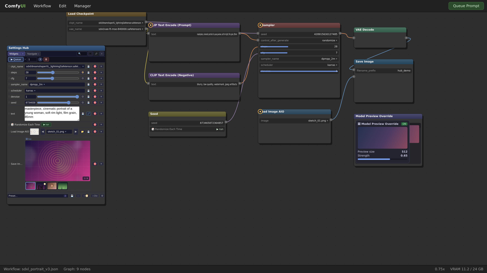

Вся логика живёт на фронте (`web/`, ES-модули) — Python-часть это заглушка,
которая не исполняется при постановке в очередь и не влияет на граф.

---

## Содержание

1. [Установка](#установка)
2. [Быстрый старт](#быстрый-старт)
3. [Возможности](#возможности)
   - [Панель-хаб и зеркала виджетов](#панель-хаб-и-зеркала-виджетов)
   - [Пиннинг: 4 пути + batch-пикер](#пиннинг-4-пути--batch-пикер)
   - [Умные зеркала: combo с поиском, слайдеры с override, кнопки](#умные-зеркала)
   - [Queue ×N и живой статус очереди](#queue-n-и-живой-статус-очереди)
   - [Пресеты 2.0](#пресеты-20)
   - [Медиа-строки и пикер файлов](#медиа-строки-и-пикер-файлов)
   - [Галерея-вьювер и фуллскрин](#галерея-вьювер-и-фуллскрин)
   - [Живые порталы: встраивание панелей нод](#живые-порталы)
   - [Плавающее окно (пин на экран)](#плавающее-окно)
   - [Точки навигации 🧭](#точки-навигации)
   - [Горячие клавиши точек](#горячие-клавиши-точек)
   - [Paste Stack 📋 (история буфера обмена)](#paste-stack)
   - [Image Compare ⇆ (A/B-сравнение)](#image-compare)
   - [Глобальные настройки ⚙](#глобальные-настройки)
4. [Как это работает](#как-это-работает)
5. [Разработка и тесты](#разработка-и-тесты)
6. [Устранение неполадок](#устранение-неполадок)

---

## Установка

**ComfyUI Manager:** Custom Nodes Manager → `Settings Hub` → Install.

**Вручную:**

```bash
cd ComfyUI/custom_nodes
git clone <url-этого-репозитория> ComfyUI-Settings-Hub
```

Перезапустите ComfyUI (после обновления — **Ctrl+F5**, см.
[устранение неполадок](#устранение-неполадок)). Нода появится в меню как
**Settings Hub**.

## Быстрый старт

1. Добавьте на граф ноду **Settings Hub**.
2. Кликните **ПКМ по любой ноде** → «📦 Add widgets to hub (batch)…» или
   «📌 Pin to Settings Hub» — виджет появится в хабе и будет зеркалить
   значение в обе стороны.
3. По желанию: разложите виджеты по вкладкам, сохраните пресет, зажмите хаб
   на экране 📌 или добавьте точки навигации 🧭.

## Возможности

### Панель-хаб и зеркала виджетов

Одна нода — один пульт. Каждая строка хаба — живое зеркало виджета ноды-источника:
значение меняется с **обеих сторон мгновенно** (реактивная шина событий, без
опроса). Строки можно перетаскивать (DnD), переименовывать, искать, удалять;
виджеты раскладываются по вкладкам (переименование — двойной клик), есть
разделители и режим скрытия служебного «хрома» (👁).

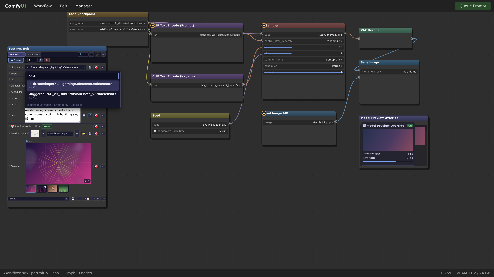

### Пиннинг: 4 пути + batch-пикер

- **ПКМ по виджету** — точечный пин конкретного контрола;
- **ПКМ по ноде** → «📌 Pin to Settings Hub ▸» (выбор хаба/вкладки/новой
  вкладки);
- **Ctrl/Cmd+ПКМ** — перехват поверх родных меню панелей;
- **Shift+ПКМ** — эскейп-хатч к нативному браузерному меню.

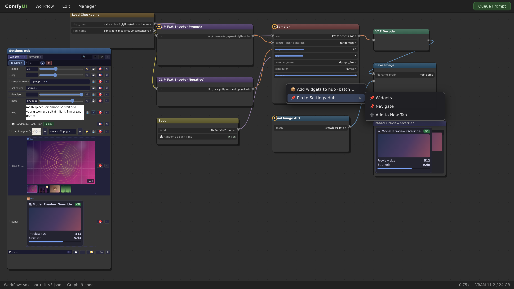

«📦 Add widgets to hub (batch)…» открывает пикер: чекбоксы по всем виджетам
ноды с типами (combo/slider/int/toggle/button/panel), выбор целевого хаба и
вкладки, «Add N» одним кликом.

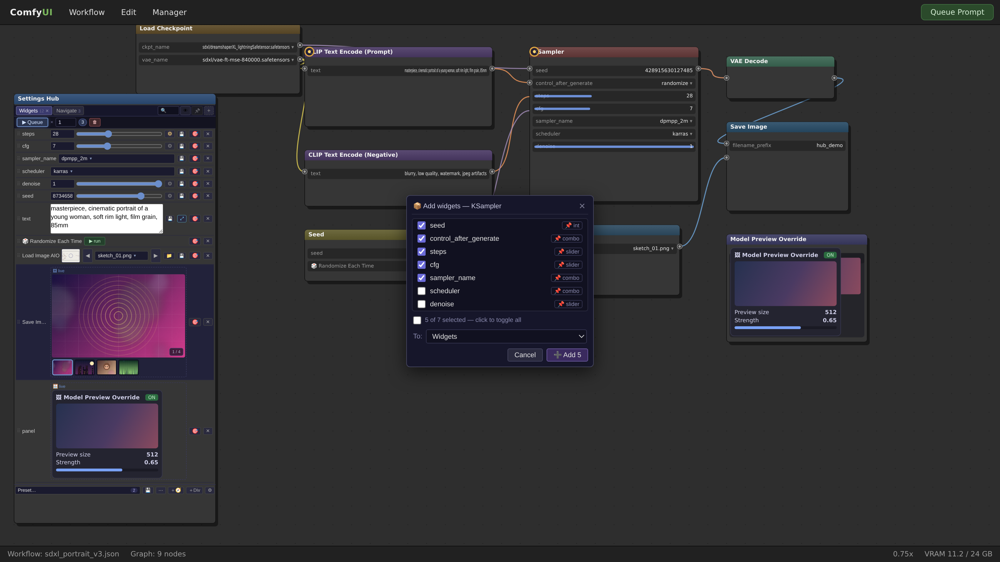

### Умные зеркала

- **Combo с живым поиском** — фильтр по подстроке (все части должны
  совпадать), длинные пути моделей показываются в две строки
  (basename жирным + каталог приглушённо), закрытый триггер остаётся
  компактным;
- **Слайдеры** — колесо мыши меняет значение; через ⚙ на строке задаются
  кастомные min/max/step с применением к реальной ноде («Push») и возвратом
  («Clear»), есть режим авто-применения; синтетические слайдеры строятся для
  «голых» чисел (seed, steps);
- **Кнопки** — зеркала кнопок нод (rgthree «🎲 Randomize Each Time» и т.п.)
  запускаются прямо из хаба, не трогая значение;
- **Текст** — однострочные и многострочные поля с ресайзом по высоте.

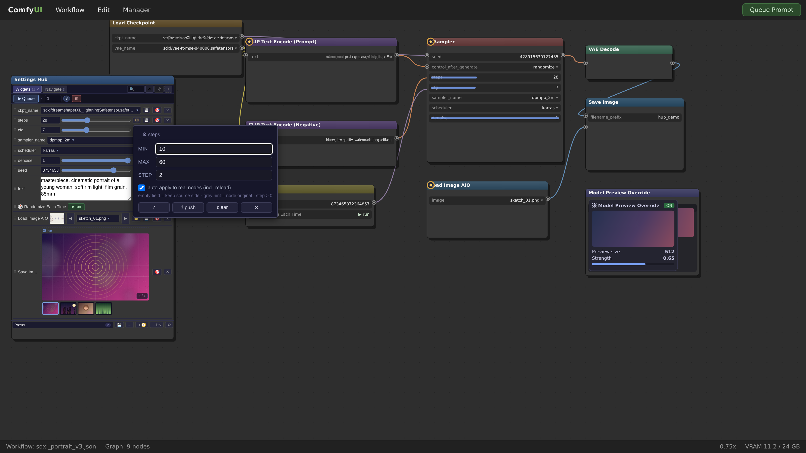

### Queue ×N и живой статус очереди

Панель ▶ **Queue** под вкладками: постановка промпта в очередь N раз
(до 1000), живой бейдж оставшихся задач из событий сервера, кнопка ⏹ отмены
выполнения. Источник истины — события `app.api` (status / executing /
execution_success), поллинг не используется. Виден на общем плане хаба
(см. [герой](#панель-хаб-и-зеркала-виджетов)).

### Пресеты 2.0

Снапшоты **активной вкладки**: быстрое сохранение, применение с инспекцией
(валидация combo, клэмп значений, частичное применение), undo, избранное,
объединение пресетов, экспорт/импорт текстом, массовое включение/исключение
строк. Точки навигации и кнопки в пресеты не попадают — только значения.

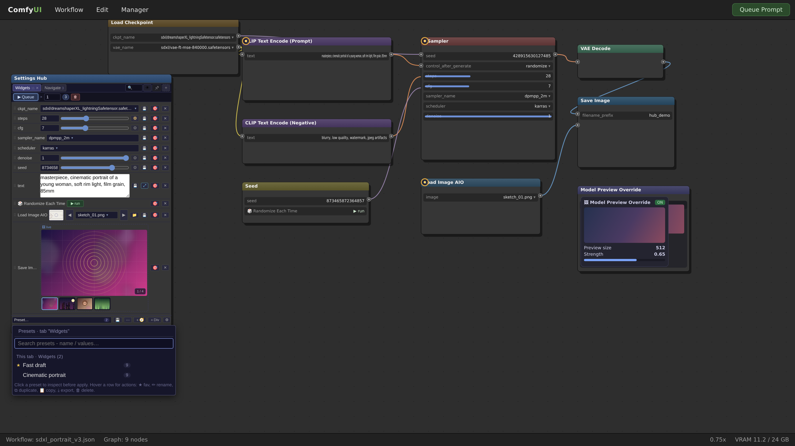

### Медиа-строки и пикер файлов

Загрузчики изображений/видео/аудио (включая «Load Image AIO») пиннятся одной
строкой: миниатюра, searchable combo файлов, кнопка upload, drag&drop и
**вставка из буфера (Ctrl+V)** прямо в строку хаба. Наведение показывает
увеличенное превью (задержка и размер настраиваются).

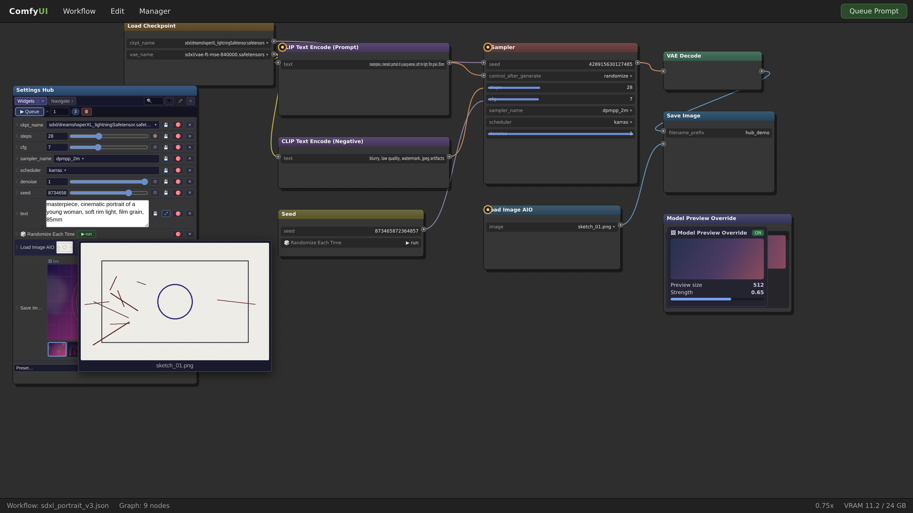

Клик по превью открывает **пикер файлов** — рекурсивный обход папок ComfyUI
(`input`/`output` и др., эндпоинт `/settings_hub/list_media` из этого репо),
фильтры по типу (All/Images/Videos/Audio/Recent), размер миниатюр, выбор
кликом.

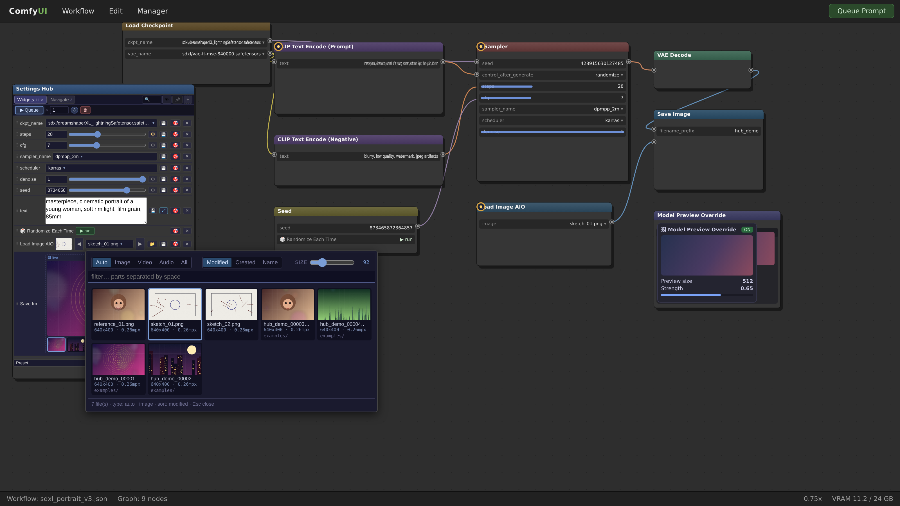

### Галерея-вьювер и фуллскрин

Строка «Pin viewer (live embed)» превращает выходную ноду (SaveImage,
PreviewImage, видео-комбайнеры…) в **батч-галерею** прямо в хабе: счётчик
кадров, миниатюры, кнопки скачивания ⬇, полноэкранный режим с навигацией
(←/→/Esc/колесо).

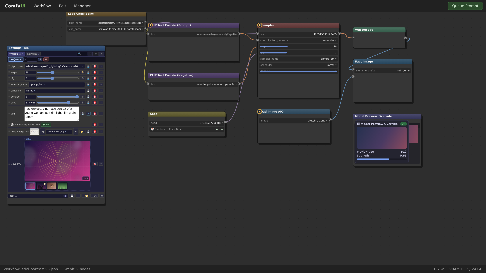

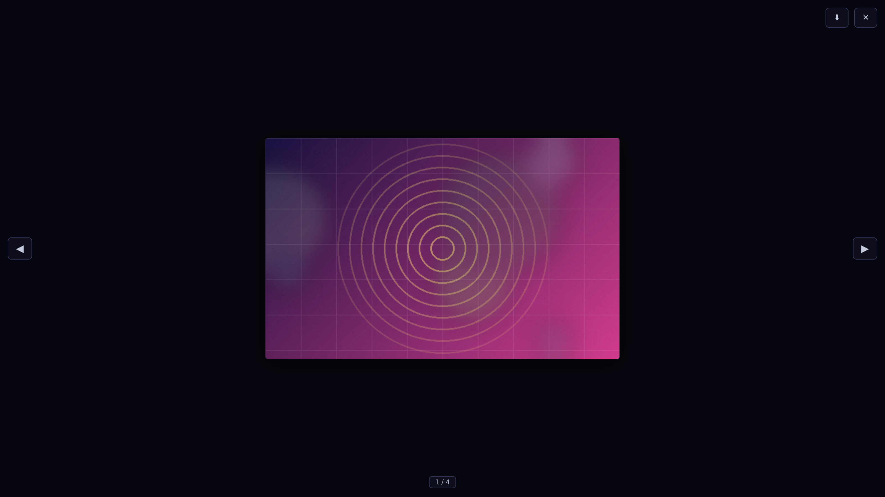

### Живые порталы

Пункты «🪟 Pin custom panel (live embed)», «🖼 Pin viewer (live embed)» и
«🎛 Pin node UI (live embed)» встраивают в хаб **живые панели** сторонних нод:
DOM-панели клонируются «призраком» (оригинал никогда не покидает ноду, клики
перенаправляются в оригинал, мутации источника перестраивают зеркало),
канвас-панели рендерятся 1:1 с форвардингом кликов. Нода остаётся полностью
рабочей на графе.

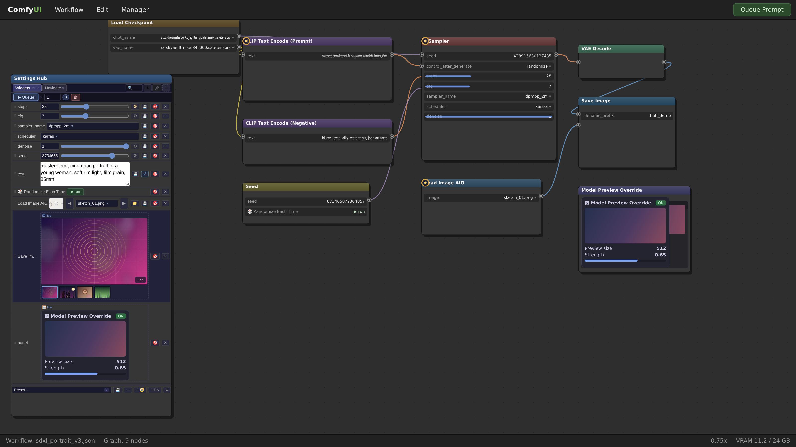

### Плавающее окно

📌 в шапке хаба отцепляет панель в **плавающее окно** поверх графа: драг за
заголовок, ресайз за грип (размер запоминается), свернутая «–» кнопка, режим
**авто-сворачивания** (окно складывается, когда курсор уходит, и раскрывается
по наведению на заголовок — тайминги в ⚙). Переживает смену воркфлоу и зумы;
файл-drag на свёрнутом окне раскрывает его для вставки.

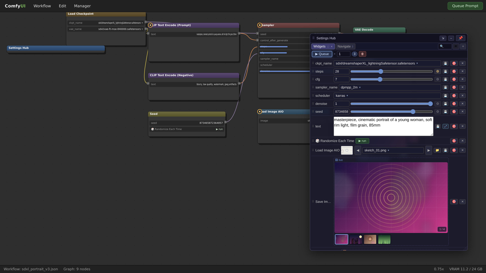

### Точки навигации

Быстрое перемещение по большим воркфлоу (включая вложенные subgraphs):

- **＋🧭** в тулбаре хаба — режим прицела: клик по канве ставит точку
  (Esc/ПКМ — отмена); либо пункт «🧭 Add navigation point here» в ПКМ-меню
  канвы;
- маркеры точек рисуются на канве и **перетаскиваются**;
- строка точки: прыжок, бейдж зума, ⌨-чип хоткея, поповер с координатами;
- прыжок ставит точку к **левому-верхнему углу вью** (отступ 80px) с
  антидрейф-камерой: абсолютная постановка со самопроверкой конвертером,
  эмпирическим пробником и settle-гвардом — прыжок одинаково точен на любом
  фронтенде (анимации входа в подграф, DPR-прослойки, «лживые» конвертеры);
- цели резолвятся по **uuid сабграфов** (двухпроходный BFS): точка переживает
  save/load и шеринг воркфлоу, а «сироты» честно помечаются ⚠;
- **v69:** при создании точки фиксируется **текущий зум канвы** — «custom zoom»
  включён по умолчанию, прыжок восстанавливает ровно тот вид, который был у
  вас перед созданием точки («= now» перекалибровывает вручную).

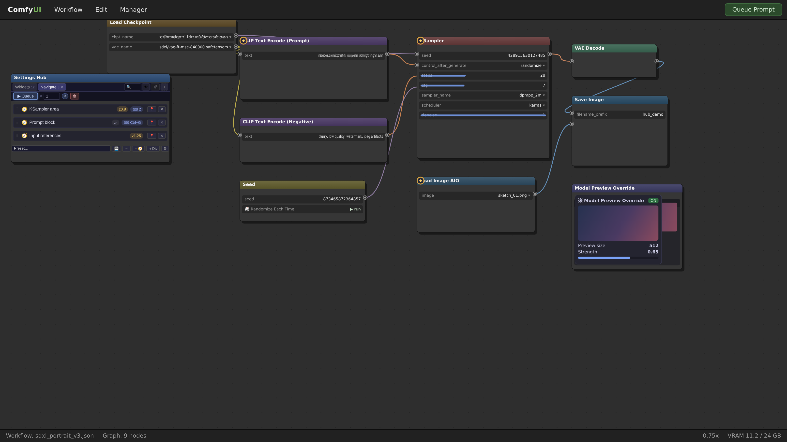

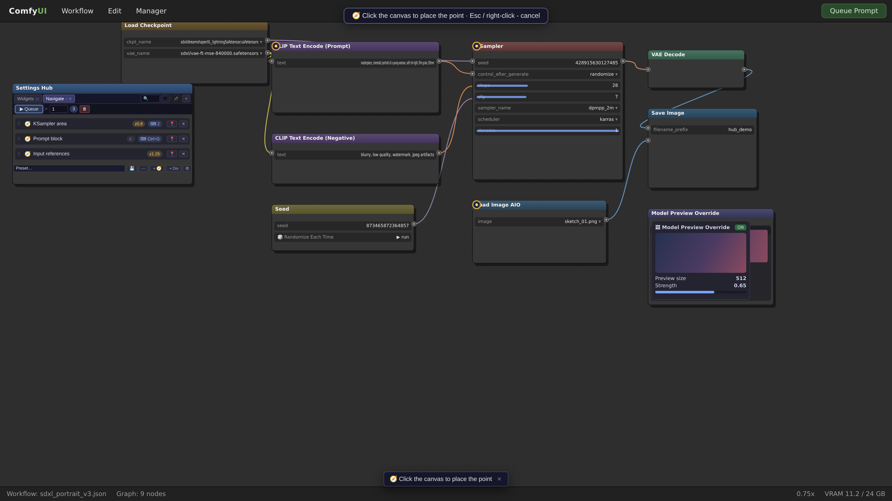

Поповер точки: координаты (read-only), «custom zoom» с полем и «= now»,
кнопка ▶ jump для проверки.

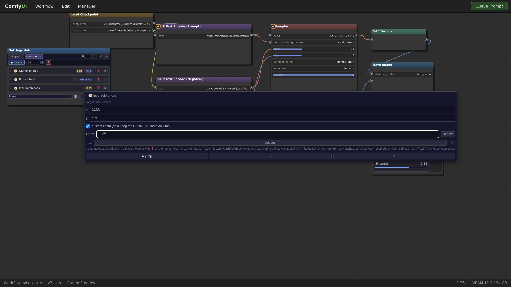

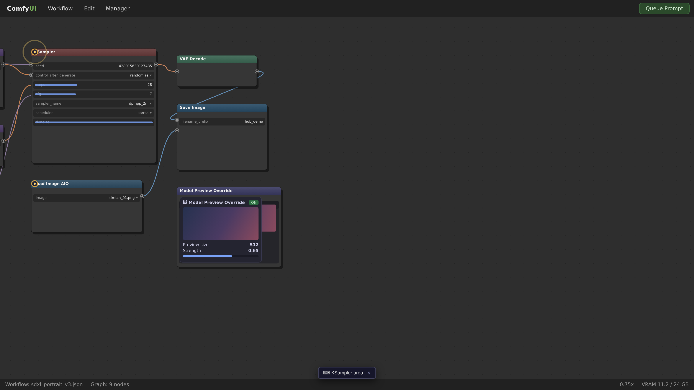

### Горячие клавиши точек

Каждой точке можно назначить **сочетание клавиш** (одиночная клавиша или
Ctrl/Alt/Shift/Meta+клавиша). Канонизация идёт по **физической клавише**
(`e.code`): назначение переживает смену раскладки — назначили Ctrl+G в EN,
нажимаете ту же клавишу в RU, точка прыгает. Дубликаты отклоняются с именем
точки-владельца; сработавший прыжок показывает тост. Движок — один
document-capture слушатель с гвард-цепочкой (поля ввода, e.repeat,
modifier-only не перехватываются; несовпадение оставляет событие полностью
родному обработчику). Часть комбинаций браузер резервирует (Ctrl+1..9,
Ctrl+T/W/N) — они неперехватываемы.

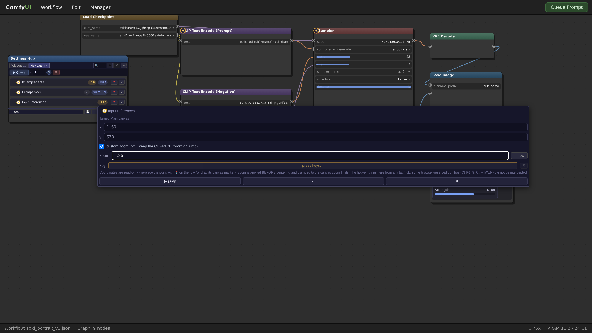

### Paste Stack

**Отдельная плавающая панель-история буфера обмена** (не вкладка хаба — хаб и
стек работают одновременно). Захват:

- клик по зоне «＋ Click or Ctrl+V» — чтение буфера через Clipboard API, а
  когда браузер не может (LAN-http или файлы из Проводника) — автоматически
  **OS-хелпер**: ComfyUI-процесс читает буфер ОС по запросу
  (`POST /settings_hub/clipboard`, только loopback + кастомный заголовок,
  ≤10 файлов / 25 МБ / 60 МБ, никаких фоновых опросов);
- `Ctrl+V` при наведении на панель;
- **drag&drop файлов из Проводника** — любые виды (видео/аудио/текст/бинарные).

Карточки: текст (превью + copy-back кликом), картинки (превью + возврат в
буфер), видео/аудио (плеер), файлы. Действия: `[→ медиа-строка]` — отправить в
первую подходящую медиа-строку хаба, `[⤓]` скачать.

**Drag прямо на ноды графа (v74 — любые виды карточек):** картинку — на
Load Image / маски, видео — на загрузчики видео (VHS «Load Video», нативный
LoadVideo), аудио — на LoadAudio, текст — на любые ноды с текстовыми полями
(CLIP Text Encode и др. — запись в строковый виджет под курсором). Нода
подсвечивается (зелёный — медиа, синий — текст), `Esc` — отмена; загрузка
через `/upload/image` и запись в combo.

Сниппеты (v72): 📌 **пины переживают вытеснение**, ✎ переименование и теги
(Enter — сохранить, Esc — отмена), поиск и фильтры типа, счётчик использований
×N, и **«→📝 в строку»** — вставка текста в последнее сфокусированное
текстовое поле хаба (или drag карточки прямо на зеркало).

**🗑 Очистить весь стек — кнопка в шапке самой панели** (второй клик
подтверждает). Список карточек полноценно скроллится с подсвеченным
скроллбаром.

**Крестика в панели нет (v75)** — свернуть можно только в капсулу кнопкой
[–]; полностью убрать панель можно лишь через настройки: ⚙ → Stack →
«Paste Stack panel: Off».

**Самодиагностика хранилища (v76):** при старте панель пробирует
`GET /settings_hub/stack/health` и вместо безликой надписи «storage
unreachable» называет точную причину: у сервера нет роутов стека (старый
py/ — обновите ВЕСЬ пак и перезапустите ComfyUI), нет связи, HTTP-код,
папка хранилища не записываема, либо версии web↔py не совпадают
(недоустановленный пак). Если хранилище работает, а py старше v76 —
зелёная заметка «storage works». Кнопка **[↻ check again]** повторяет
пробу и ресинк без перезагрузки страницы.

**Scope стека (v77) — общий или на каждый воркфлоу:** ⚙ → Stack →
«Stack scope»:

- **Shared (по умолчанию)** — один стек для всех воркфлоу, как было всегда;
- **Per-workflow** — у каждого воркфлоу свой стек: идентификатор привязки
  хранится В САМОМ ФАЙЛЕ воркфлоу (`extra_data.settingshubStackId` —
  «стек сохраняется в воркфлоу»), записи лежат на сервере в
  `user/settings_hub/stack/workflows/<id>/`, шапка панели показывает
  бейдж `@workflow`, а 🗑 чистит только активный scope. Текстовые
  сниппеты дополнительно зеркалируются в файл воркфлоу и
  **восстанавливаются автоматически**, если серверное хранилище этого
  воркфлоу пусто (воркфлоу перенесли на другую машину / почистили папку
  user). Переключение режима НИКОГДА не переносит записи — каждый scope
  хранит свои.

**Хранение — на сервере ComfyUI** (`user/default/settings_hub/stack/`,
index.json + items/): стек портабелен (переезжает вместе с папкой ComfyUI),
общий для localhost/127.0.0.1/LAN и любых браузеров, переживает очистку
site-data. Лимиты настраиваются в ⚙ → Stack (по умолчанию 100 записей,
серверные потолки 500 / 200 МБ). Если роуты недоступны (обновили без
перезапуска ComfyUI) — панель работает в режиме сессии и честно об этом
пишет.

> ⚠ Clipboard API браузера доступен только на localhost/https — на LAN-http
> работают Ctrl+V, drag&drop и OS-хелпер (клик по зоне paste тоже сработает —
> через хелпер).

### Image Compare

ПКМ на **медиа-строке**, **миниатюре галереи** или **карточке стека** →
«Add to Compare»: первое добавление занимает слот **A**, второе — **B**,
дальнейшие сдвигают очередь; есть явные «→ A» / «→ B», свап и очистка слотов.
Режимы:

| Режим | Как работает |
| --- | --- |
| **Wipe** | перетаскиваемая шторка (или клик по сцене) — A слева, B справа |
| **Fade** | слайдер кроссфейда B поверх A (0–100%) |
| **Blink** | клик по сцене мигает A↔B |
| **Diff** | пиксельная разница \|A−B\| × gain 1–10× |

Сравнение **обновляется само после каждого рана** (панель перечитает
источники по событию `executed`) — удобно для A/B-тестирования промптов и
семплеров: поменялся файл у загрузчика — картинка в сравнении подменилась.
Позиция, размер, режим, gain и позиция шторки запоминаются.

### Глобальные настройки

⚙ в шапке хаба — единый попап настроек:

| Секция | Что настраивается |
| --- | --- |
| **Sync** | скорость догоняющего обновления зеркал (0 = только события), звук видео (mute/volume) |
| **Previews** | задержка показа превью, «грация» скрытия, размер S/M/L/XL, автовоспроизведение |
| **Picker** | размер миниатюр пикера файлов |
| **Pin window** | тайминги авто-сворачивания плавающего окна (fold / re-open) |
| **Navigation** | маркеры точек на канве, пункт ПКМ-меню, тумблер горячих клавиш |
| **Stack** | Paste Stack вкл/выкл, лимит записей (25–500). Очистка — кнопкой 🗑 в шапке самой панели. Крестика у панели нет — выключение только этим переключателем |

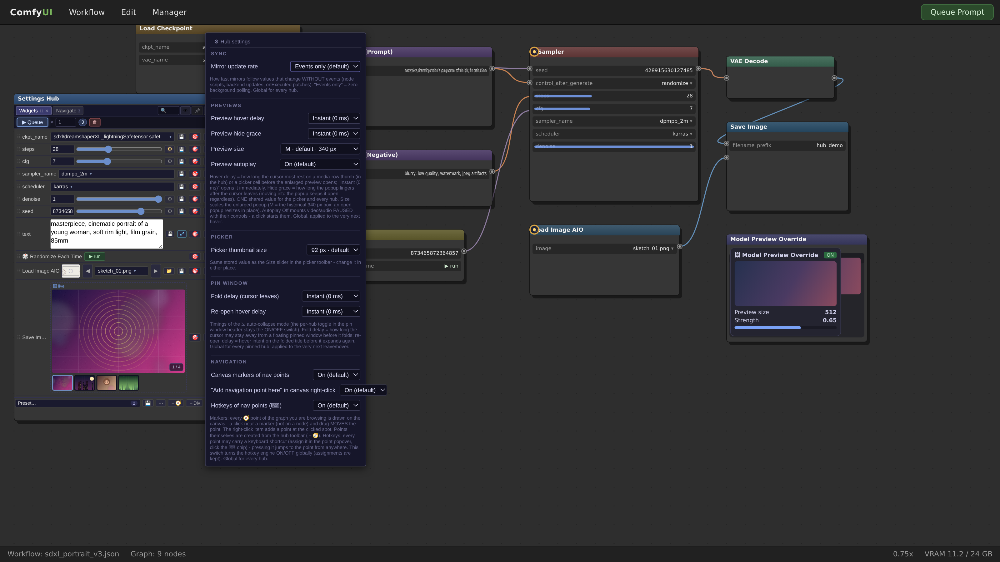

## Как это работает

- **Реактивная синхронизация без опроса.** Любой поток значений идёт через
  `writeTargetValue` под общим edit-lock'ом (`beginEdit/endEdit`), который
  подавляет эхо-обновления; DOM хаба обновляется rAF-коалисингом. Дополнительно
  можно включить догоняющий поллер в ⚙ (по умолчанию выключен).
- **Python-часть — заглушка.** `py/settings_hub.py` регистрирует ноду без
  `OUTPUT_NODE`, `noop()` возвращает `()` — узел не исполняется при постановке
  в очередь. Единственный реальный эндпоинт — `py/media_list.py`
  (`/settings_hub/list_media`), рекурсивный листинг медиа-папок.
- **Кросс-графовый резолвер.** Цели биндингов ищутся по всем живым графам
  (включая subgraphs) по id + имени; «уплывшие» заголовки чинятся
  (title-drift repair), цепочки владельцев SubgraphNode отслеживаются.
- **Классификация виджетов самолечится.** `detectWidgetType` — единственный
  источник истины; старые конфиги мигрируют на живом виджете, DOM-панели
  всегда сильнее строкового типа.
- **Жизненный цикл свежего хаба.** UI строится только у нод «в графе»;
  доставка через `onAdded` + лестницу ретраев + DOM-truth свип + финальный
  reconfigure — хаб не остаётся пустым.
- **Защита от кэша.** Точка входа штампует `__SettingsHubBuild = "v69"` до
  импортов, каждый модуль саморепортится; устаревший файл из кэша браузера
  называется в консоли И в видимом баннере (Ctrl+F5), при этом регистрация
  fail-open — один мёртвый модуль не глушит остальные меню.

## Разработка и тесты

Тесты — реальные смоуки: копируют `web/*.js` в песочницу с заглушкой
ComfyUI и гоняют настоящие модули (Node ESM + jsdom).

```bash
npm i jsdom          # единственная jsdom-зависимость
node tests/smoke_nav.mjs    # движок точек навигации, камера, хоткеи, UI-путь, stack-bridge, глаз-скрытие (239 проверок)
node tests/smoke_stack.mjs  # Paste Stack: захват/дедуп/лимиты/file-режим/drag/сниппеты/скролл/clear-в-шапке/без-крестика/self-check/scope-режимы + Image Compare (210)
node tests/smoke_menu.mjs   # регистрация меню, fail-open, баннер деградации (24)
python3 tests/py_test_clipboard.py   # OS-хелпер буфера + файловый/patch/health-роуты стека + per-workflow scope (69)
```

Структура:

```text
__init__.py            регистрация ноды + WEB_DIRECTORY
py/settings_hub.py     заглушка ноды (без OUTPUT_NODE)
py/media_list.py       эндпоинт /settings_hub/list_media
py/stack_store.py      роуты /settings_hub/stack* (хранилище Paste Stack, /health - самодиагностика v76, ?wf= - per-workflow scope v77)
py/clipboard_helper.py роут /settings_hub/clipboard (чтение буфера ОС, loopback+заголовок)
web/settings_hub.js    загрузчик: баннер, guard, fail-open регистрация
web/stack.js           Paste Stack: панель, захват, drag, сниппеты
web/compare.js         Image Compare: A/B wipe/fade/blink/diff
web/core.js            конфиг, классификация виджетов, резолверы, слайдер-override
web/hub_ui_renderer.js весь UI хаба: вкладки, строки, попапы, layout
web/sync.js            шина обновлений + edit-lock
web/sync_manager.js    хуки реактивности на целевых виджетах
web/context_menu.js    меню пиннинга + batch-пикер
web/portal_manager.js  живые встраивания (ghost-зеркала, canvas-порталы)
web/viewer_gallery.js  галерея-вьювер + фуллскрин + скачивание
web/preset_manager.js  пресеты 2.0
web/nav_points.js      точки навигации: резолвер, камера, маркеры, хоткеи
web/global_settings.js глобальные настройки (localStorage)
web/dnd_manager.js     drag&drop строк
web/pins.js            счётчик пинов для бейджа
web/styles.css         тёмная тема (*.hub-*)
tests/                 смоуки (jsdom)
docs/screenshots/      скриншоты для этого README
```

Скриншоты в этом README сняты с **настоящего веб-пака** расширения,
запущенного в headless-Chromium с заглушкой окружения ComfyUI (граф отрисован
тестовой сценой, ответы `/view` и `/settings_hub/list_media` подменены
локально) — вся вёрстка, попапы и логика принадлежат продакшн-коду `web/`.

## Устранение неполадок

- **После обновления пропали пункты меню / хаб пуст** — жёсткое обновление
  страницы (**Ctrl+F5**). Расширение само detects устаревший кэш: в консоли и
  баннером внизу экрана называются конкретные файлы.
- **Проверка свежести билда** — F12 → консоль: первой строкой идёт
  `[SettingsHub] web build: v69 - …`.
- **Хаб не запиннил виджет** — Shift+ПКМ открывает нативное меню (эскейп-хатч);
  мёртвые кнопки-спейсеры намеренно не пинятся.
- **Хоткей точки не срабатывает** — проверьте тумблер ⚙ → Navigation →
  «Hotkeys of nav points»; браузерные резервации (Ctrl+1..9, Ctrl+T/W/N)
  неперехватываемы.
- **Точка навигации с ⚠** — её граф не найден (воркфлоу изменён): переставьте
  точку через 📍 на строке.
